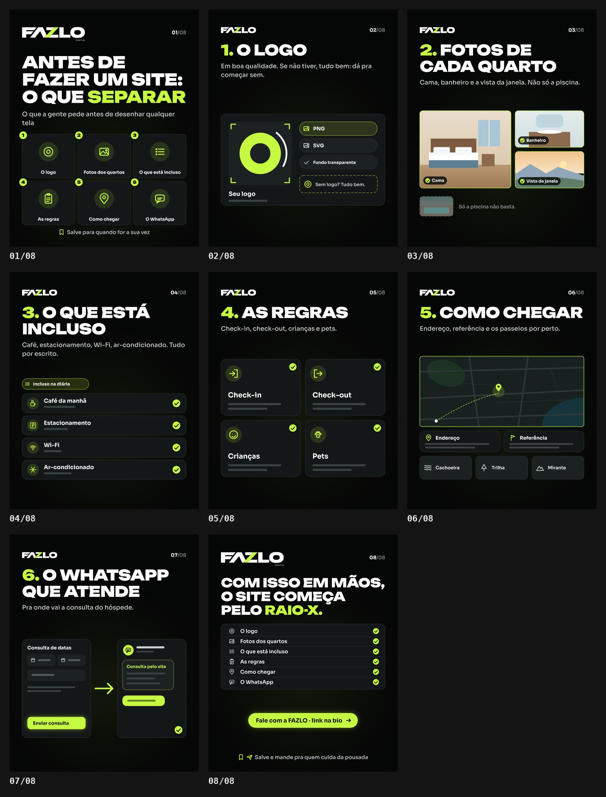

# FAZLO Digital — carrossel "Antes de fazer um site: o que separar"

**Status: prévia · aguardando aprovação. Posta ter 20/10, às 17h.**

8 slides 1080×1350 (4:5), no mesmo padrão dos carrosséis anteriores: fundo `#050606`, lima `#C6FA41`, Unbounded + Sora, FAZLO DIGITAL na capa e no fechamento, FAZLO compacto nos internos e topo abaixo do contador do Instagram.



| Slide | Conteúdo | Ilustração (genérica) |
|---|---|---|
| 01 | **ANTES DE FAZER UM SITE: O QUE SEPARAR** · "O que a gente pede antes de desenhar qualquer tela" · "Salve para quando for a sua vez" | os 6 itens, com selos 1–6 |
| 02 | **1. O LOGO** · "Em boa qualidade. Se não tiver, tudo bem: dá pra começar sem." | logo de exemplo com marcas de corte, formatos PNG e SVG, fundo transparente, "Sem logo? Tudo bem." |
| 03 | **2. FOTOS DE CADA QUARTO** · "Cama, banheiro e a vista da janela. Não só a piscina." | fotos ilustradas de cama, banheiro e vista; a piscina aparece apagada |
| 04 | **3. O QUE ESTÁ INCLUSO** · "Café, estacionamento, Wi-Fi, ar-condicionado. Tudo por escrito." | lista com os 4 itens e o que é detalhe em barras |
| 05 | **4. AS REGRAS** · "Check-in, check-out, crianças e pets." | 4 cartões, com os valores em barras |
| 06 | **5. COMO CHEGAR** · "Endereço, referência e os passeios por perto." | mapa abstrato, endereço, referência e passeios (cachoeira, trilha, mirante) |
| 07 | **6. O WHATSAPP QUE ATENDE** · "Pra onde vai a consulta do hóspede." | consulta de datas no site, seta e a conversa recebida (sem logo de app) |
| 08 | **COM ISSO EM MÃOS, O SITE COMEÇA PELO RAIO-X.** · pílula "Fale com a FAZLO · link na bio" · "Salve e mande pra quem cuida da pousada" | os 6 itens conferidos |

**Regras seguidas:** nenhuma pousada real, nenhum número (datas, endereço e detalhes aparecem como barras), nenhum logo de terceiros.

**Revisão:** `npm run carousel -- antes-de-fazer-um-site` renderiza e confere tamanho, opacidade, bordas livres (40 px) e o canto do contador do Instagram. Resultado: **aprovado**.

```
carrosseis/antes-de-fazer-um-site/
  carrossel.json   src/slides.js   output/01.png … 08.png, previa.jpg, revisao/
```
