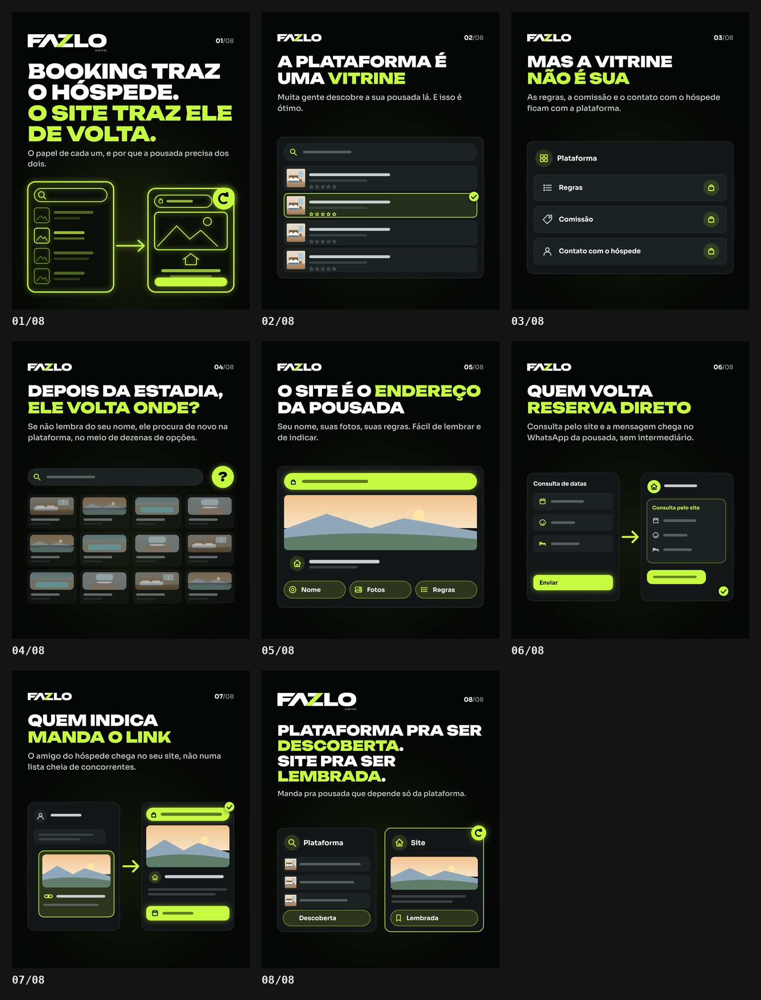

# FAZLO Digital — carrossel "Booking traz o hóspede. O site traz ele de volta."

**Status: concluído · em avaliação. Posta sáb 24/10, às 17h.**

8 slides 1080×1350 (4:5), no mesmo padrão dos carrosséis anteriores: fundo `#050606`, lima `#C6FA41`, Unbounded + Sora, FAZLO DIGITAL na capa e no fecho, FAZLO compacto nos internos e topo abaixo do contador do Instagram. A capa segue o modelo novo, com uma ilustração grande em traço lima no estilo das capas v2 da série. Os trechos entre asteriscos saem em lima, e os textos são os pedidos, sem alteração.

| Slide | Título (lima em destaque) | Ilustração (genérica) |
|---|---|---|
| 01 | Booking traz o hóspede. **O site traz ele de volta.** · "O papel de cada um, e por que a pousada precisa dos dois." | em traço lima: card de plataforma (lista de pousadas, sem logo) → card do site da pousada com seta de retorno |
| 02 | A plataforma é uma **vitrine** | lista de pousadas com busca, uma delas em destaque |
| 03 | Mas a vitrine **não é sua** | card "Plataforma" com Regras, Comissão e Contato com o hóspede, cada um com cadeado |
| 04 | Depois da estadia, **ele volta onde?** | busca com "?" e uma grade de 12 opções parecidas |
| 05 | O site é o **endereço** da pousada | site com barra de endereço em destaque, foto e as pílulas Nome, Fotos e Regras |
| 06 | Quem volta **reserva direto** | consulta de datas no site → mensagem que chega na pousada (sem logo de app) |
| 07 | Quem indica **manda o link** | conversa com um link compartilhado → o site da pousada aberto |
| 08 | Plataforma pra ser **descoberta**. Site pra ser **lembrada**. · "Manda pra pousada que depende só da plataforma." | os dois cards lado a lado: Plataforma/Descoberta e Site/Lembrada |

**Regras seguidas:** nenhum logo de marca (Booking, Airbnb, WhatsApp, Instagram), nenhum número, telefone, nome de pessoa ou dado real; os textos dos cards aparecem como barras. A palavra "Booking" só aparece no título da capa, e "WhatsApp" só no texto de apoio do slide 06, como você escreveu.

**Revisão:** `npm run carousel -- booking-e-site`: **aprovado** (tamanho, opacidade, bordas livres de 40 px, canto do contador e recorte 3:4 da capa).
