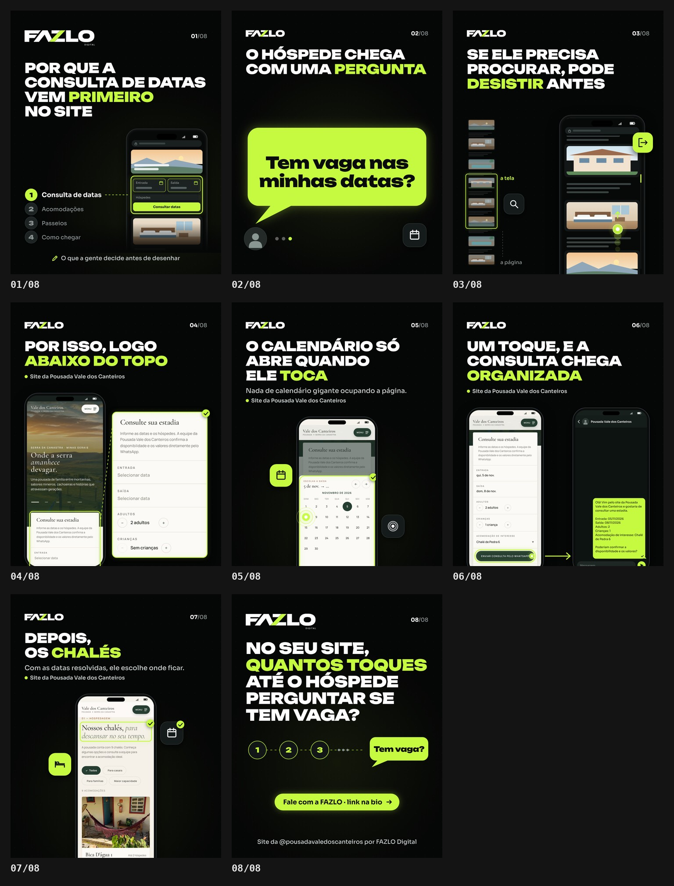

# FAZLO Digital — carrossel "Por que a consulta de datas vem primeiro"

Carrossel da @fazlodigital. Peça estática: **8 slides PNG 1080×1350 (4:5)**.

**Status: prévia · aguardando aprovação.**

🖼 **Folha:** [`output/previa.jpg`](output/previa.jpg) · Slides: [`output/01.png`](output/01.png) … [`output/08.png`](output/08.png) · Revisão: [`output/revisao/`](output/revisao)



---

## Conceito

O que a FAZLO decide antes de desenhar: o hóspede chega com uma pergunta ("Tem vaga nas minhas datas?"), então a consulta de datas fica **logo abaixo do topo**. O calendário só abre quando ele toca, a consulta chega organizada no WhatsApp e, com as datas resolvidas, vêm os chalés.

- **Slides 01–03:** ilustrações genéricas, sem lugar real.
- **Slides 04–07:** **capturas reais** do site da Pousada Vale dos Canteiros, com uso autorizado pelo cliente. São as mesmas dos Reels "Como funciona o raio-x" e "Conheça o site da Pousada Vale dos Canteiros"; nenhuma imagem nova foi capturada.

## Slides

| | Título | Texto | Visual |
|---|---|---|---|
| 01 | **POR QUE A CONSULTA DE DATAS VEM PRIMEIRO NO SITE** ("PRIMEIRO" em lima) | rodapé: "O que a gente decide antes de desenhar" | uma página genérica no celular, com a consulta de datas (Entrada, Saída, Hóspedes, "Consultar datas") logo depois do topo e acesa em lima; ao lado, a ordem da página: **1 Consulta de datas**, depois Acomodações, Passeios, Como chegar |
| 02 | **O HÓSPEDE CHEGA COM UMA PERGUNTA** | — | balão lima grande "Tem vaga nas minhas datas?", avatar genérico e reticências de quem espera resposta |
| 03 | **SE ELE PRECISA PROCURAR, PODE DESISTIR ANTES** | — | página longa genérica no celular, rolando (toque com rastro), **sem formulário à vista**; ao lado, o minimapa da página inteira com a janela "a tela"; chips de busca e de saída |
| 04 | **POR ISSO, LOGO ABAIXO DO TOPO** | "Site da Pousada Vale dos Canteiros" | captura real do topo (foto "Onde a serra amanhece devagar.") com o bloco "Consulte sua estadia" logo abaixo, aceso; ampliação real do bloco com **Entrada, Saída, Adultos, Crianças** |
| 05 | **O CALENDÁRIO SÓ ABRE QUANDO ELE TOCA** | "Nada de calendário gigante ocupando a página." | captura real do seletor de datas aberto (novembro, dia 5 escolhido, o toque no 8), que ocupa a tela só enquanto ele escolhe |
| 06 | **UM TOQUE, E A CONSULTA CHEGA ORGANIZADA** | "Site da Pousada Vale dos Canteiros" | captura real do formulário preenchido com o toque em **"Enviar consulta pelo WhatsApp"** → a **mesma conversa recriada do Reel do case**, com a mensagem real que o site monta, enviada ✓ |
| 07 | **DEPOIS, OS CHALÉS** | "Com as datas resolvidas, ele escolhe onde ficar." | captura real de "Nossos chalés", com o título aceso |
| 08 | **NO SEU SITE, QUANTOS TOQUES ATÉ O HÓSPEDE PERGUNTAR SE TEM VAGA?** ("QUANTOS TOQUES" em lima) | pílula lima "Fale com a FAZLO · link na bio"; rodapé: "Site da @pousadavaledoscanteiros por FAZLO Digital" | toques 1 · 2 · 3 · … até o balão "Tem vaga?" |

**Regras:**

- **Depoimentos:** a seção "Quem passou por aqui conta melhor" não aparece; as capturas foram feitas sem ela.
- **Nada inventado:** o que aparece nas telas reais é o que o site mostra. A mensagem da conversa é o texto que o site monta, conferido na checagem do Reel do case.
- **A conversa recriada não é o WhatsApp:** avatar genérico (silhueta), só o nome da pousada, sem número e sem logo oficial.

## Direção de arte

O padrão é o do carrossel "O que o hóspede procura antes de reservar":

- fundo `#050606` com grade de pontos, verde-limão `#C6FA41` e branco;
- **Unbounded** 900 nos títulos e **Sora** nos textos;
- topo abaixo do contador nativo do Instagram: logo **FAZLO DIGITAL** (360 px) na capa e no fechamento, **FAZLO** compacto (200 px) nos internos, e o contador "01/08";
- o lima marca o que responde (a consulta de datas, o calendário, o botão, os chalés) e o **toque**, o mesmo gesto do Reel do case;
- celulares com as telas reais do site sangram pelo pé, como no carrossel anterior.

## Arquivos

```
carrosseis/consulta-de-datas-primeiro/
  carrossel.json   # formato, fontes, assets (capturas reaproveitadas dos Reels), QA
  src/slides.js    # os 8 slides (FZC.define)
  output/          # 01.png … 08.png, previa.jpg, revisao/
```

```bash
npm run carousel -- consulta-de-datas-primeiro      # render + QA (prévia e revisão)
npm run dev                                         # preview: /core/carousel.html?c=consulta-de-datas-primeiro
```
