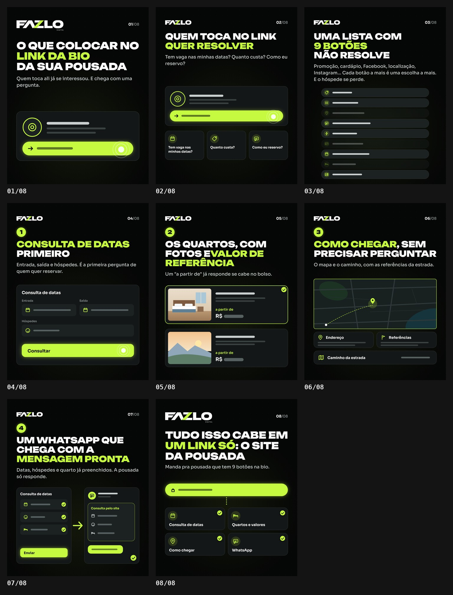

# FAZLO Digital — carrossel "O que colocar no link da bio da sua pousada"

**Status: concluído · em avaliação. Posta qui 22/10, às 17h.**

8 slides 1080×1350 (4:5), no mesmo padrão dos carrosséis anteriores: fundo `#050606`, lima `#C6FA41`, Unbounded + Sora, FAZLO DIGITAL na capa e no fecho, FAZLO compacto nos internos e topo abaixo do contador do Instagram. Os trechos entre asteriscos saem em lima, e os textos são os pedidos, sem alteração.



| Slide | Título (lima em destaque) | Ilustração (genérica) |
|---|---|---|
| 01 | O que colocar no **link da bio** da sua pousada · "Quem toca ali já se interessou. E chega com uma pergunta." | perfil genérico com o link da bio em destaque e um toque |
| 02 | Quem toca no link **quer resolver** · "Tem vaga nas minhas datas? Quanto custa? Como eu reservo?" | o perfil e as três perguntas em cartões |
| 03 | Uma lista com **9 botões** não resolve · "Promoção, cardápio, Facebook, localização, Instagram…" | pilha de 9 botões genéricos (só ícone e barra), 3 apagados |
| 04 | **1** · **Consulta de datas** primeiro | formulário: entrada, saída, hóspedes e "Consultar" |
| 05 | **2** · Os quartos, com fotos e **valor de referência** | 2 quartos ilustrados com "a partir de R$ ▬" (valor em barra) |
| 06 | **3** · **Como chegar**, sem precisar perguntar | mapa abstrato, endereço, referências e caminho da estrada |
| 07 | **4** · Um WhatsApp que chega com a **mensagem pronta** | consulta preenchida → conversa recebida (sem logo de app) |
| 08 | Tudo isso cabe em **um link só**: o site da pousada · "Manda pra pousada que tem 9 botões na bio." | um link genérico que abre os 4 itens |

**Regras seguidas:** nenhum logo de marca (WhatsApp, Instagram, Linktree, Facebook), nenhum telefone, nome de pessoa ou dado real; valores e endereços aparecem como barras. As palavras "Facebook" e "Instagram" só existem no texto de apoio do slide 03, como você escreveu, e não nas ilustrações.

**Revisão:** `npm run carousel -- link-da-bio` renderiza e confere tamanho, opacidade, bordas livres (40 px) e o canto do contador do Instagram. Resultado: **aprovado**.

```
carrosseis/link-da-bio/
  carrossel.json   src/slides.js   output/01.png … 08.png, previa.jpg, revisao/
```
