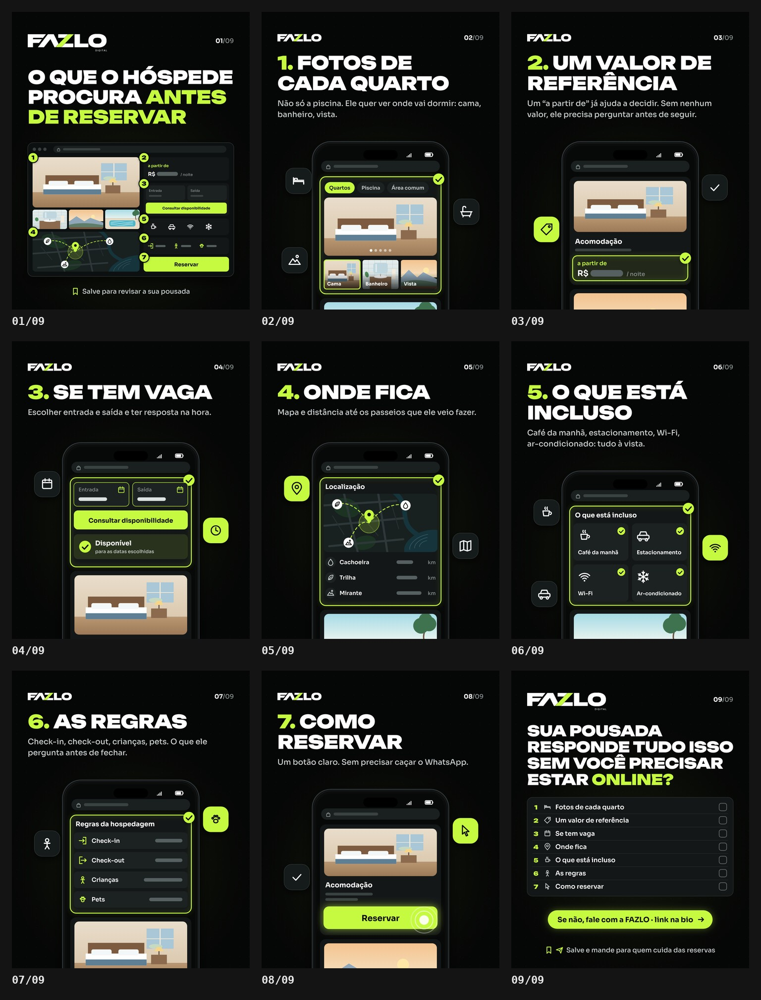

# FAZLO Digital — carrossel "O que o hóspede procura antes de reservar"

Carrossel da @fazlodigital. Peça estática: **9 slides PNG 1080×1350 (4:5)**.

**Status: ajustes aplicados · aguardando aprovação final.**

🖼 **Prévia:** [`output/previa.jpg`](output/previa.jpg) · Slides: [`output/01.png`](output/01.png) … [`output/09.png`](output/09.png) · Revisão: [`output/revisao/`](output/revisao)



---

## Conceito

São as 7 informações que o hóspede procura antes de reservar. Cada uma aparece numa **tela de site** (a assinatura visual da @fazlodigital), mostrando onde aquela informação fica.

- **Itens:** o celular fica no mesmo lugar em todos. Passar os slides é como rolar o mesmo site.
- **Capa:** mostra a página inteira no navegador, com as 7 respostas numeradas.
- **Fechamento:** devolve a pergunta para o dono da pousada, com um checklist dos 7 itens para revisar o próprio site.

## Slides

| | Título | Texto | Tela |
|---|---|---|---|
| 01 | **O QUE O HÓSPEDE PROCURA ANTES DE RESERVAR** (ANTES DE RESERVAR em lima) | rodapé: "Salve para revisar a sua pousada" | navegador com a página inteira e os selos 1–7 em cada seção |
| 02 | **1. FOTOS DE CADA QUARTO** | Não só a piscina. Ele quer ver onde vai dormir: cama, banheiro, vista. | galeria com a aba "Quartos" ativa (Piscina e Área comum ao lado), foto grande do quarto, miniaturas Cama, Banheiro e Vista |
| 03 | **2. UM VALOR DE REFERÊNCIA** | Um "a partir de" já ajuda a decidir. Sem nenhum valor, ele precisa perguntar antes de seguir. | card da acomodação com o bloco "a partir de · R$ ▬ / noite" em destaque |
| 04 | **3. SE TEM VAGA** | Escolher entrada e saída e ter resposta na hora. | campos **Entrada** e **Saída** preenchidos, botão **Consultar disponibilidade** e a resposta "Disponível para as datas escolhidas", **sem calendário aberto** |
| 05 | **4. ONDE FICA** | Mapa e distância até os passeios que ele veio fazer. | mapa ilustrado (ruas, rio, represa, mata) com o pin da pousada e rotas até os passeios; lista **Cachoeira, Trilha, Mirante** (público da Serra da Canastra e de Capitólio) com a distância como barra + "km" |
| 06 | **5. O QUE ESTÁ INCLUSO** | Café da manhã, estacionamento, Wi-Fi, ar-condicionado: tudo à vista. | grade com os 4 itens, cada um com ícone e ✓ |
| 07 | **6. AS REGRAS** | Check-in, check-out, crianças, pets. O que ele pergunta antes de fechar. | "Regras da hospedagem": Check-in, Check-out, Crianças, Pets, com os valores como barras |
| 08 | **7. COMO RESERVAR** | Um botão claro. Sem precisar caçar o WhatsApp. | botão **Reservar** grande, em lima, com o toque |
| 09 | **SUA POUSADA RESPONDE TUDO ISSO SEM VOCÊ PRECISAR ESTAR ONLINE?** (ONLINE? em lima) | pílula lima "Se não, fale com a FAZLO · link na bio"; rodapé: "Salve e mande para quem cuida das reservas" | checklist dos 7 itens com caixas vazias, para o dono revisar a própria pousada |

**Interfaces ilustrativas e genéricas:**

- nenhuma pousada real e nenhum nome;
- nenhum número inventado: preço, horários, distâncias e datas aparecem como **barras**;
- a barra de endereço tem cadeado, mas não tem domínio;
- as "fotos" são ilustrações planas.

## Direção de arte

A identidade é a mesma do Reel "Instagram não é site":

- **Cores:** fundo `#050606` com grade de pontos, verde-limão `#C6FA41` e branco. O lima marca o número de cada item, o que responde (seção em destaque, ✓, botões) e as palavras-chave.
- **Tipografia:**
  - **Unbounded** 900 nos títulos e nos números;
  - **Sora** nos textos (35 px), nas telas e nos rodapés.
- **Topo (SVGs do kit oficial, intactos), com a logo à esquerda e o contador "01/09" à direita (número em branco, total em cinza):**
  - **capa e fechamento:** **FAZLO DIGITAL** com 360 px de largura. O "DIGITAL" fica com cerca de 8 px de altura no arquivo, legível no celular;
  - **itens (02–08):** a versão compacta **FAZLO** (`FAZLO-logo-branca-transparente.svg`, sem o "DIGITAL"), com 200 px. É a versão que o kit indica para aplicações pequenas.
- **Ilustrações:** quarto, banheiro, vista da serra e área externa com piscina e árvore de copa redonda, em vez de coqueiro, para combinar com a serra.
- **Telas:** a seção que responde ao item tem contorno lima, brilho e selo ✓. Abaixo dela aparece o próximo bloco do site, cortado pela borda do slide, sugerindo rolagem.
- **Elementos vivos:** chips com ícones em volta do celular, ligados a cada item (cama, banheira, vista; etiqueta; calendário e relógio; pin e mapa; café, Wi-Fi, carro; criança e pata; cursor).
- **Celular:** tem a mesma largura e o mesmo centro em todos os itens. Nos slides de texto curto ele sobe, para não deixar uma faixa vazia.

## Ajustes aprovados

Ajustes da primeira prévia:

- **Passeios do slide 05:** "Praia, Trilha, Cachoeira" virou "Cachoeira, Trilha, Mirante". O mapa trocou a orla por rio e represa.
- **Logo:** FAZLO DIGITAL com 360 px na capa e no fechamento, e FAZLO compacta com 200 px nos itens.
- **Aprovados sem mudança:**
  - abas "Quartos / Piscina / Área comum";
  - "Disponível para as datas escolhidas";
  - checklist do slide 09;
  - palavras em lima;
  - topo mais baixo por causa do contador do Instagram.

## Revisão

O render roda `tools/carousel_qa.py` e gera:

- [`relatorio.txt`](output/revisao/relatorio.txt);
- [`tamanho-real.jpg`](output/revisao/tamanho-real.jpg): os slides na largura de um celular (412 pt), para conferir a leitura;
- [`capa-no-perfil.jpg`](output/revisao/capa-no-perfil.jpg): a capa no recorte 3:4 da grade do perfil.

**Resultado: aprovado.** Os 9 slides passaram nestas conferências:

- 1080×1350;
- imagem opaca;
- bordas laterais e topo livres (40 px); o celular sangra só pelo pé, de propósito;
- canto do contador nativo do Instagram ("1/9", no alto à direita) livre: o topo da peça começa abaixo dele;
- capa com o conteúdo dentro do recorte 3:4 da grade do perfil (x 34–1046).

## Arquivos-fonte

```
carrosseis/o-que-o-hospede-procura/
  carrossel.json       # título, status, formato, fontes, parâmetros de QA
  src/slides.js        # os 9 slides (FZC.define): telas, ilustrações, ícones, logo do kit
  output/              # 01.png … 09.png, previa.jpg, revisao/
```

### Como renderizar (na raiz do repositório)

```bash
npm run carousel -- o-que-o-hospede-procura              # 9 PNGs + prévia + revisão
npm run carousel -- o-que-o-hospede-procura --slides 2,9 # só alguns slides
npm run dev                                              # preview: /core/carousel.html?c=o-que-o-hospede-procura (G: guias)
```
