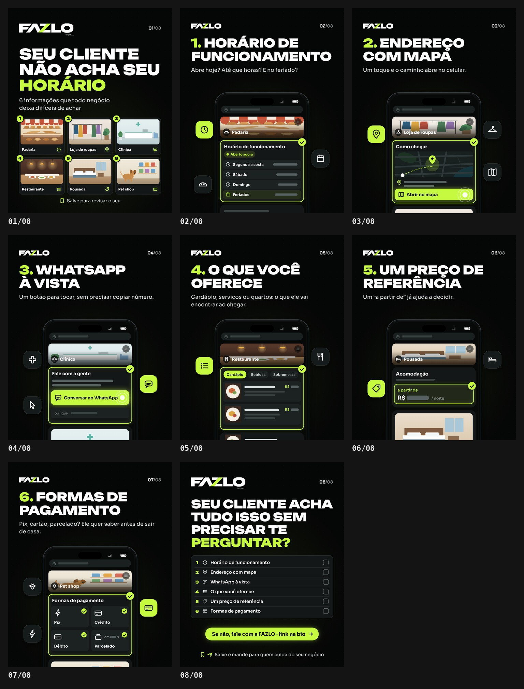

# FAZLO Digital — carrossel "Seu cliente não acha seu horário"

Carrossel da @fazlodigital. Peça estática: **8 slides PNG 1080×1350 (4:5)**. Público: **negócios em geral**, não só pousada.

**Status: prévia · aguardando aprovação.**

🖼 **Folha:** [`output/previa.jpg`](output/previa.jpg) · Slides: [`output/01.png`](output/01.png) … [`output/08.png`](output/08.png) · Revisão: [`output/revisao/`](output/revisao)



---

## Conceito

São as 6 informações que todo negócio deixa difíceis de achar. Cada item aparece na **mini tela de site de um tipo de negócio diferente**, com a informação em destaque (contorno lima e ✓).

- **Itens:** o celular fica **na mesma posição** em todos. Passar os slides é como olhar o site de seis negócios diferentes.
- **Capa:** os seis negócios lado a lado, cada um com o número e o ícone da sua informação.
- **Fechamento:** um checklist dos 6 itens com caixas vazias, para o dono revisar o próprio negócio.

## Slides

| | Título | Texto | Tela |
|---|---|---|---|
| 01 | **SEU CLIENTE NÃO ACHA SEU HORÁRIO** ("HORÁRIO" em lima) | subtítulo: "6 informações que todo negócio deixa difíceis de achar"; rodapé: "Salve para revisar o seu" | os 6 negócios (padaria, loja de roupas, clínica, restaurante, pousada, pet shop) com os selos 1–6 e o ícone de cada informação |
| 02 | **1. HORÁRIO DE FUNCIONAMENTO** | Abre hoje? Até que horas? E no feriado? | **padaria**: "Horário de funcionamento", com "Aberto agora" e as linhas Segunda a sexta, Sábado, Domingo e **Feriados**, cada horário como barra |
| 03 | **2. ENDEREÇO COM MAPA** | Um toque e o caminho abre no celular. | **loja de roupas**: "Como chegar", com mapa e pin, endereço como barras e o botão **Abrir no mapa** com o toque |
| 04 | **3. WHATSAPP À VISTA** | Um botão para tocar, sem precisar copiar número. | **clínica**: "Fale com a gente", com o botão **Conversar no WhatsApp** (ícone genérico de conversa, sem logo) e o toque; o número fica só como barra apagada |
| 05 | **4. O QUE VOCÊ OFERECE** | Cardápio, serviços ou quartos: o que ele vai encontrar ao chegar. | **restaurante**: abas Cardápio · Bebidas · Sobremesas e os pratos, com nome, descrição e preço como barras |
| 06 | **5. UM PREÇO DE REFERÊNCIA** | Um "a partir de" já ajuda a decidir. | **pousada**: "Acomodação", com o bloco "a partir de · R$ ▬ / noite" em destaque |
| 07 | **6. FORMAS DE PAGAMENTO** | Pix, cartão, parcelado? Ele quer saber antes de sair de casa. | **pet shop**: "Formas de pagamento", com Pix, Crédito, Débito e Parcelado ("em ▬ x"), cada um com ✓ |
| 08 | **SEU CLIENTE ACHA TUDO ISSO SEM PRECISAR TE PERGUNTAR?** ("PERGUNTAR?" em lima) | pílula lima "Se não, fale com a FAZLO · link na bio"; rodapé: "Salve e mande para quem cuida do seu negócio" | checklist dos 6 itens com caixas vazias |

**Interfaces ilustrativas e genéricas:**

- nenhum negócio real e nenhum nome: o topo de cada mini site mostra só o **tipo** de negócio;
- **horários, preços, endereços e números aparecem como barras**, sem números inventados;
- "WhatsApp" aparece só como texto do botão, com ícone genérico de conversa, sem logo oficial; Pix usa um ícone genérico (raio), sem logo oficial;
- as "fotos" são ilustrações planas: balcão de padaria, arara de roupas, recepção de clínica, mesa de restaurante, quarto de pousada e pet shop com um cachorro.

## Direção de arte

O padrão é o dos carrosséis anteriores:

- fundo `#050606` com grade de pontos, verde-limão `#C6FA41` e branco;
- **Unbounded** 900 nos títulos e números, **Sora** nos textos e nas telas;
- topo abaixo do contador nativo do Instagram: **FAZLO DIGITAL** (360 px) na capa e no fechamento, **FAZLO** compacto (200 px) nos itens, e o contador "01/08";
- o número do item em lima no título; a seção que responde ao item tem contorno lima, brilho e selo ✓;
- chips com ícones em volta do celular, ligados a cada item (relógio, calendário, pão; pin, mapa, cabide; conversa, cursor, cruz; lista, talheres; etiqueta, cama; cartão, raio, pata).

## Arquivos

```
carrosseis/seu-cliente-nao-acha-seu-horario/
  carrossel.json   # formato, fontes, QA
  src/slides.js    # os 8 slides (FZC.define)
  output/          # 01.png … 08.png, previa.jpg, revisao/
```

```bash
npm run carousel -- seu-cliente-nao-acha-seu-horario      # render + QA (prévia e revisão)
npm run dev                                               # preview: /core/carousel.html?c=seu-cliente-nao-acha-seu-horario
```
