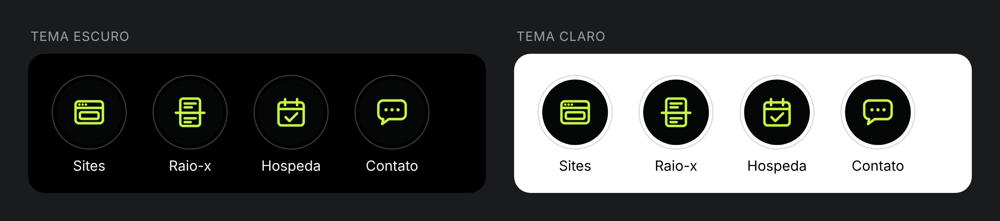

# FAZLO Digital — capas de destaques do perfil

Capas dos destaques do perfil da @fazlodigital. O Instagram usa um Story (1080×1920) como capa e recorta um **círculo** no centro.

**Status: concluído · aprovado.**



| Destaque | Ícone | Arquivo |
|---|---|---|
| **Sites** | janela de navegador: barra de cima (com os 3 botões) e um bloco de conteúdo | [`sites.png`](sites.png) |
| **Raio-x** | ficha atravessada por uma linha de scan horizontal, que passa das bordas | [`raio-x.png`](raio-x.png) |
| **Hospeda** | calendário com um check (ícone FAZLO, não a logo do Hospeda) | [`hospeda.png`](hospeda.png) |
| **Contato** | balão de conversa genérico com três pontinhos (sem logo de app) | [`contato.png`](contato.png) |

## Regras

- **Fundo:** `#050606` liso.
- **Ícone:** lima `#C6FA41`, em traço linear com espessura uniforme (**27 px** nas 4), pontas e cantos arredondados. É a mesma linguagem do `icon()` dos Reels.
- **Sem texto:** o nome do destaque já aparece embaixo do círculo no perfil.
- **Sem logos de terceiros.**
- **Círculo seguro:** centro (540, 960), diâmetro 720 px. Cada ícone fica centrado nele pelo próprio contorno e ocupa **~45% do diâmetro**:

  | Capa | Tamanho do ícone | % do diâmetro |
  |---|---|---|
  | Sites | 328×268 px | 45,6% |
  | Raio-x | 340×328 px | 47,2% (a linha de scan passa das bordas) |
  | Hospeda | 304×316 px | 43,9% |
  | Contato | 328×286 px | 45,6% |

- **Nome do destaque:** o Instagram aceita até **15 caracteres** e mostra cerca de 9 a 10 embaixo do círculo. Os 4 nomes (Sites, Raio-x, Hospeda, Contato) aparecem inteiros. O 4º se chamaria "Fale com a FAZLO", mas tem 16 caracteres e virou **"Contato"**.

## Prévia e revisão

- [`previa-perfil.png`](previa-perfil.png): os 4 círculos como aparecem no app, com os nomes embaixo, em tema escuro e claro. Usa o anel cinza do Instagram e mostra cada capa com ~64 px, na densidade de um celular (3x). O círculo seguro de 720 px vira a foto de 56 px dentro do anel.
- [`revisao/capas-com-guias.png`](revisao/capas-com-guias.png): as capas inteiras com o círculo seguro (vermelho) e o diâmetro-alvo do ícone (azul).
- [`revisao/relatorio.txt`](revisao/relatorio.txt) confere, em cada capa:
  - 1080×1920 e opaca;
  - fundo liso;
  - só as duas cores da marca;
  - o ícone dentro do círculo seguro, com o tamanho certo e centrado.

## Arquivos-fonte

```
destaques/
  destaques.json     # cores, círculo seguro, escala e traço dos ícones, lista das capas
  src/icones.cjs     # os 4 ícones em SVG (grade de 100 unidades, mesma escala e mesmo traço)
  svg/<id>.svg       # cada capa em vetor (1080x1920), para editar em qualquer programa
  <id>.png           # capas finais
  previa-perfil.png
  revisao/
```

```bash
npm run destaques     # SVG + PNG das 4 capas, prévia do perfil e revisão (tools/destaques.cjs + tools/destaques_qa.py)
```
