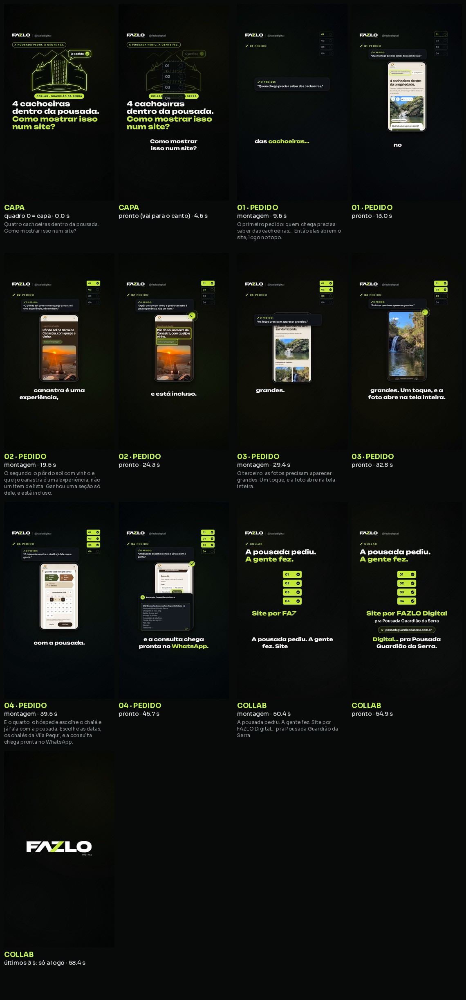

# FAZLO Digital — Reel collab "A pousada pediu. A gente fez."

**Collab @fazlodigital + @pousadaguardiaodaserra.** Publicação: **a definir**. **Status: versão 2 (28/10) · revisão aprovada · em avaliação.**

**Versão 2 (28/10):** o site passou a ter 4 cachoeiras (Capivara, Paraíso dos Pássaros, Oratório e Gruta do Lobo Guará, com o Encontro das Águas à parte). Telas recapturadas, gancho "Quatro cachoeiras…", narração nova com a voz v4 (eleven_v4) e legenda palavra por palavra ligada.

Os 4 pedidos da Pousada Guardião da Serra e a tela **real** do site no ar (pousadaguardiaodaserra.com.br) resolvendo cada um. Feito com o motor da [Série Explica](../../series/explica) no modo collab (`"progresso": "pedidos"`), com a identidade da FAZLO Digital e todas as regras do formato.

| | |
|---|---|
| **Vídeo** | [`output/fazlo-digital-case-guardiao-da-serra.mp4`](output/fazlo-digital-case-guardiao-da-serra.mp4): 1080×1920, 60 fps, **58,4 s**, com legenda palavra por palavra |
| **Capa** | [`output/capa.png`](output/capa.png): o quadro 0, ilustrada (cachoeira em traço lima com o balão "O pedido ✓"), no recorte 3:4 |
| **Quadros-chave** | [`output/quadros-chave/`](output/quadros-chave): gancho, pôr do sol, consulta no WhatsApp e fecho, com a legenda |
| **Storyboard** | [`output/storyboard.jpg`](output/storyboard.jpg) + [`output/progresso.jpg`](output/progresso.jpg) (a lista dos pedidos funcionando) |
| **Revisão** | [`output/revisao/relatorio-tecnico.txt`](output/revisao/relatorio-tecnico.txt): **aprovado** · −14,1 LUFS · pico −1,6 dBTP · voz 12 dB acima dos efeitos · legenda: sincronia média 23 ms, máx. 78 ms; 17 páginas (4 juntadas), a mais curta 1,54 s |
| **Roteiro** | [`../../series/explica/episodios/case-guardiao-da-serra.json`](../../series/explica/episodios/case-guardiao-da-serra.json) |
| **Narração** | [`../../series/explica/audio/case-guardiao-da-serra/voz/`](../../series/explica/audio/case-guardiao-da-serra/voz) (uma geração inteira por capítulo, com o histórico em `falas.json`) |



## Capítulos (versão 2)

| Cap | Tempo | Tela | Fala (destaque da legenda em negrito) |
|---|---|---|---|
| 0 · capa | 0,0–5,4 s | capa ilustrada (cachoeira em traço lima, balão "O pedido ✓", selos) e o título "4 cachoeiras dentro da pousada. / Como mostrar isso num site?"; a lista dos 4 pedidos aparece vazia e vai para o canto | "Quatro **cachoeiras** dentro da pousada. Como mostrar isso num site?" (pergunta aberta: desce no fim, como no português falado) |
| 01 | 5,4–14,1 s | "Quem chega precisa saber das cachoeiras." → o topo do site com "4 cachoeiras dentro da propriedade." | "O primeiro pedido: quem chega precisa saber das **cachoeiras**… Então elas abrem o site, logo no topo." |
| 02 | 14,1–25,4 s | a seção do pôr do sol, com o chip "Incluso na hospedagem" realçado | "O segundo: o **pôr do sol** com vinho e queijo canastra é uma experiência, não um item de lista. Ganhou uma seção só dele, e está incluso." |
| 03 | 25,4–33,9 s | a seção "Quatro cachoeiras sem sair da fazenda." rola, um toque na Cachoeira do Oratório e ela abre na tela inteira | "O terceiro: as **fotos** precisam aparecer grandes. Um toque, e a foto abre na tela inteira." |
| 04 | 33,9–46,8 s | datas (2 a 5/11) → card da Vila Pequi em destaque → Pôr do Sol 03 → a mensagem que o site monta, num balão genérico | "E o quarto: o hóspede escolhe o chalé e já fala com a pousada. Escolhe as datas, os chalés da Vila Pequi, e a consulta chega pronta no **WhatsApp**." |
| fecho | 46,8–58,4 s | "A pousada pediu. / A gente fez.", a lista com os 4 ✓, "Site por FAZLO Digital" em lima, "pra Pousada Guardião da Serra" e o site; nos últimos 3 s, só a logo | "A pousada pediu. A gente fez. Site por **FAZLO Digital**… pra Pousada Guardião da Serra." |

**Voz (eleven_v4, Raquel, estabilidade 0,50, semelhança 0,75):** 3 candidatas por capítulo em `../../series/explica/audio/case-guardiao-da-serra/voz/candidatos/`. Escolhidas: gancho s21026 e fecho s20111 (de ouvido, pelo Willian), pedidos 1–3 s5043, s3060, s5077 e pedido 4 s20094 (pela nota da conferência).
- O v4 não faz pausa com reticências, ponto + parágrafo nem `<break>` ([teste](../../testes/voz-v4-pausas)). Por isso o **respiro foi inserido** depois da geração, só onde a tomada já estava abaixo de −60 dB: 0,34 s entre "…com a pousada." e "Escolhe…" (a tomada tinha 0,06 s; ponto a −77 dB) e 0,39 s antes de "pra Pousada Guardião da Serra" (a tomada tinha 0,11 s; ponto a −80 dB). A revisão confere, amostra por amostra, que o áudio do vídeo é a tomada original + silêncio.
- Exceção registrada no roteiro: o fecho s20111 mede 5,7% de ênfase em "Site por FAZLO Digital" (mínimo 6%), escolhido de ouvido.
- A narração da versão 1 (eleven_multilingual_v2) fica no histórico do git.

## As telas reais

`node reels/case-guardiao-da-serra/captura.cjs` abre o site no ar no Chromium (390 px de largura, 3×, com toque) e grava os quadros em [`telas/`](telas) ([prévia](telas/previa.jpg)), com as caixas do que o vídeo realça e a mensagem que o site monta em `telas.json`. Antes de capturar, ela confere que o site mostra 4 cachoeiras e nenhum "3 cachoeiras", "Recanto dos Pássaros", "Grinalda" ou "[confirmar]", e que o chip "Incluso na hospedagem" está na seção do pôr do sol; se algo falhar, ela para.

- Todo número de telefone é desfocado. O campo "Telefone" da consulta fica vazio, e a mensagem sai com "Nome: -" e "Telefone: -".
- Os botões só com o ícone do WhatsApp ficam ocultos; nos botões com texto ("Enviar pelo WhatsApp"), só o ícone some. Nenhum logo de app no vídeo.
- O celular é genérico, sem marca. Nada fora do site real: as telas são quadros do site, sem retoque.

As amostras de voz da versão 1 estão em [`amostras/`](amostras); as da versão 2 (v4), com as medições, em [`amostras-v4/`](amostras-v4).

## Refazer

```bash
node reels/case-guardiao-da-serra/captura.cjs                 # as telas (só se o site mudar)
series/explica/scripts/episodio.sh case-guardiao-da-serra     # do roteiro ao vídeo revisado (a narração já está gerada)
```
