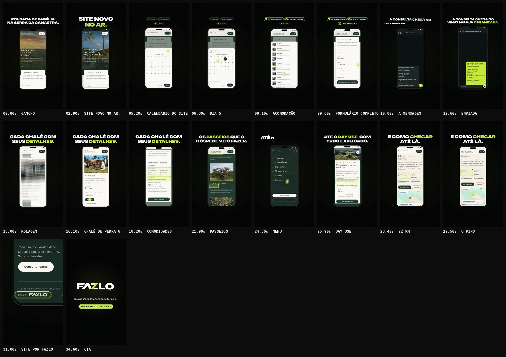

# FAZLO Digital — "Conheça o site da Pousada Vale dos Canteiros"

Reel da @fazlodigital (pasta `case-vale-dos-canteiros`). Usa a mesma identidade, o mesmo motor e a mesma linguagem de trilha dos Reels anteriores.

**Status: concluído · em avaliação.**

**Formato:** 9:16 (1080×1920), **35,4 s**, 60 fps, H.264 + AAC 48 kHz, áudio em −14 LUFS. 100% motion graphics. As telas são **capturas reais** do site da Pousada Vale dos Canteiros, com uso autorizado pelo cliente.

▶ **Vídeo:** [`output/fazlo-digital-case-vale-dos-canteiros.mp4`](output/fazlo-digital-case-vale-dos-canteiros.mp4)
🖼 **Capa:** [`output/capa.png`](output/capa.png) · Storyboard: [`output/storyboard.jpg`](output/storyboard.jpg) · Revisão: [`output/revisao/`](output/revisao)



---

## Conceito: o toque do hóspede

O gesto central é o **toque**: um círculo lima com centro branco, como a ponta de um dedo.

- **Tocar:** o círculo afunda e solta uma onda lima.
- **Rolar:** ele arrasta a página com um rastro curto e solta; a página segue no embalo.
- **Entre um alvo e outro:** desliza.

O hóspede navega pelo site real, no celular, do jeito que faria antes de reservar.

## Roteiro (100 BPM · 1 tempo = 0,6 s)

| Tempo | Cena | O que acontece |
|---|---|---|
| 0–4,2 s | **Gancho** | **POUSADA DE FAMÍLIA / NA SERRA DA CANASTRA.** sobe palavra por palavra (o 1º quadro já tem texto). O celular sobe com o topo real do site, e o carrossel troca de foto como no site, em 480 ms: "Onde a serra *amanhece* devagar." → "Portas abertas, *rede na* varanda.". Em 2,4 s, "o corte": **SITE NOVO / NO AR.**, com "NO AR." em lima, e a barra de endereço com o domínio real. |
| 4,2–13,8 s | **A consulta** | O toque rola até "Consulte sua estadia" e preenche o formulário real, um toque por tempo (tabela abaixo). Acima do celular, três etiquetas (Datas · Hóspedes · Chalé) se preenchem com o que foi escolhido. Com tudo preenchido, há uma pausa de 1,4 s antes do toque em "Enviar consulta pelo WhatsApp". A tela troca para uma **conversa recriada** e a mensagem real vira um balão enviado ✓. **A CONSULTA CHEGA NO / WHATSAPP JÁ ORGANIZADA.** fica 3 s na tela, 2,5 s deles com a mensagem já enviada. |
| 13,8–19,8 s | **Chalés** | A conversa sai e o site volta. O toque rola pelos cartões (Bica D'água 1 a 5) até o **Chalé de Pedra 6**, o mesmo da consulta, e toca "Ver detalhes". O modal real abre, o toque rola dentro dele, e **Comodidades** e **Alimentação** acendem. O toque fecha o modal tocando fora do painel. **CADA CHALÉ COM / SEUS DETALHES.** |
| 19,8–24,0 s | **Passeios** | Rolagem até "Viver a Canastra". Um arrasto com embalo passa pelos cartões, e as distâncias reais acendem quando cruzam a tela: **300 m da pousada · a pé**, **4 km da pousada** e **na propriedade · 4 km · 4x4 ou caminhada**. **OS PASSEIOS QUE O / HÓSPEDE VEIO FAZER.** |
| 24,0–27,0 s | **Day Use** | MENU → "Reservar Day Use" → o modal real. **Das 10h às 17h**, **Acesso às 04 cachoeiras da pousada** e **Almoço mineiro incluído** acendem, um por vez. O toque fecha no ×. **ATÉ O DAY USE, COM / TUDO EXPLICADO.** |
| 27,0–30,0 s | **Como chegar** | Rolagem até "Onde estamos": **22 km · estrada de terra** acende e o toque pousa no pino do **mapa real**, que pulsa. Nada externo é aberto. **E COMO CHEGAR / ATÉ LÁ.** |
| 30,0–32,4 s | **Assinatura** | Rolagem rápida até o rodapé real e zoom de cerca de 3× em **"Site por [logo FAZLO]"**, com um anel lima que se fecha. O rodapé foi capturado em 4x, então o zoom fica nítido. |
| 32,4–35,4 s | **CTA** | A logo **FAZLO DIGITAL** se monta centralizada (SVG do kit, 720 px). Depois entram **Sua pousada também pode ter o seu** e a pílula lima **Fale com a FAZLO · link na bio**. |

### Os toques da consulta

| Instante | Toque | O que o site faz |
|---|---|---|
| 4,0 s | arrasto | a página rola do topo até o formulário |
| 4,8 s | **Entrada** | o calendário do próprio site abre (outubro de 2026) |
| 5,4 s | **→** | novembro de 2026 |
| 6,0 s | **5** | "Escolha a saída · 5 de nov. → …" |
| 6,6 s | **8** | o calendário fecha sozinho: no celular o site não pede "Aplicar" depois da saída. Entrada "qui, 5 de nov.", Saída "dom, 8 de nov." |
| 7,2 s | **+ crianças** | "1 criança" |
| 7,8 s | **Acomodação de interesse** | a lista abre |
| 8,4 s | **Chalé de Pedra 6** | a lista fecha com o chalé escolhido |
| 8,8–10,2 s | pausa | o formulário completo fica à vista |
| 10,2 s | **Enviar consulta pelo WhatsApp** | troca para a conversa recriada |
| 11,0 s | enviar | a mensagem vira balão enviado ✓ |

**A conversa recriada** não é o WhatsApp:

- fundo escuro genérico, seta de voltar e avatar genérico (silhueta);
- só o nome **Pousada Vale dos Canteiros** no topo, sem número e sem logo oficial;
- a mensagem é **o texto real que o site monta** no clique em "Enviar consulta pelo WhatsApp", capturado com o `wa.me` interceptado ([`mensagem.txt`](src/assets/site/mensagem.txt)):

```
Olá! Vim pelo site da Pousada Vale dos Canteiros e gostaria de consultar uma estadia.

Entrada: 05/11/2026
Saída: 08/11/2026
Adultos: 2
Crianças: 1
Acomodação de interesse: Chalé de Pedra 6

Poderiam confirmar a disponibilidade e os valores?
```

## Telas reais e checagem

- **Reaproveitadas do Reel "Como funciona o raio-x":**
  - a página inteira no celular (faixas `m-00`..`m-10`) e o mapa de "Onde estamos" (`m-map`);
  - a checagem de dados dele.
  - O script de captura confere que a página atual tem as mesmas seções e a mesma altura dessas faixas (sim).
- **Capturas complementares:** [`scripts/capture.cjs`](scripts/capture.cjs) → [`src/assets/site/`](src/assets/site), no celular (390×844 pt, 2x), com movimento reduzido para o carrossel não trocar sozinho:
  - as 5 fotos do topo, cada uma escolhida pelo seu botão "Foto n de 5";
  - o cabeçalho nos dois estados (transparente no topo, claro depois de rolar), com fundo transparente;
  - cada passo da consulta, incluindo o calendário real (outubro, novembro, dia 5) e a lista de acomodações;
  - o modal do Chalé de Pedra 6: o conteúdo rolável inteiro, emendado do topo ao fim, e o botão fixo;
  - o MENU aberto e o modal do Day Use, sobre a página parada no fim de "Viver a Canastra";
  - a faixa final da página até o rodapé, e o rodapé em 4x.
- **Coordenadas:** o [`manifest.json`](src/assets/site/manifest.json) guarda a rolagem de cada tela e a caixa de cada toque. O Reel toca exatamente onde o site tem cada botão.
- **Escurecimentos:** a cor e a opacidade do fundo escurecido do calendário, da lista e dos modais foram medidas nas próprias capturas.
- **Telas abertas = faixas:** as telas capturadas na rolagem do formulário, do chalé e do Day Use coincidem com as faixas reaproveitadas, com diferença média de 1 a 2 níveis de cor (só compressão JPEG).
- **Depoimentos:** a seção "Quem passou por aqui conta melhor" é **removida da página antes de cada captura**. Não aparece em nenhuma imagem.
- **Nada inventado:** cada dado novo foi conferido no site ao vivo, com o trecho onde aparece, em [`checagem.txt`](src/assets/site/checagem.txt). São 28 itens, todos encontrados. Entre eles:
  - "Uma pousada de família" (topo) e "pousada de ambiente familiar" (A pousada);
  - os textos das fotos 1 e 2 do carrossel;
  - o calendário, as datas e os hóspedes, e o Chalé de Pedra 6 na lista;
  - a mensagem, idêntica ao modelo do código do site;
  - Comodidades e Alimentação do Chalé de Pedra 6;
  - as distâncias dos três primeiros passeios;
  - os itens do Day Use;
  - "22 km · estrada de terra";
  - "Site por" com a logo de `alt="Fazlo Digital"` e o link para `fazlodigital.com.br`.
- **Folha de revisão das capturas, com cada toque marcado:** [`output/revisao/capturas.jpg`](output/revisao/capturas.jpg).

## Direção de arte

- **Cores:** fundo `#050606` com grade de pontos que respira, verde-limão `#C6FA41` e branco.
  - O lima marca o toque, as palavras-chave, as etiquetas preenchidas, os destaques ✓ e o balão enviado.
- **Tipografia (fontes oficiais):** Unbounded 900 nos títulos; Sora nas etiquetas, na conversa e na barra de endereço.
- **Celular:**
  - grande e centralizado (tela de 480 px), entre y 448 e 1553;
  - fora da coluna de botões à direita e acima do rodapé;
  - os títulos ficam acima dele, na faixa y 240–440;
  - o celular respira devagar, e a câmera avança um pouco na conversa e faz o zoom final no rodapé.
- **Destaques:** contorno lima que se fecha, preenchimento leve e ✓.
  - Ficam presos à página, então rolam junto com ela, ou ao modal, rolando dentro dele.
- **Logo:** SVGs do kit oficial: 720 px no CTA e 560 px na capa, com o "DIGITAL" legível.

## Som

Trilha e efeitos **sintetizados do zero** (numpy/scipy), seguindo os cues da animação (68 eventos). A paleta é a dos Reels anteriores: 100 BPM, Lá bemol maior.

| Cena | O que toca |
|---|---|
| gancho | pad e vidro esparsos enquanto o celular sobe; **"o corte"** da assinatura em SITE NOVO NO AR., e o groove entra leve |
| a consulta | groove leve, com espaço para os toques: cada toque é um clique macio afinado, em notas que sobem do Entrada até o Enviar; as folhas do site sobem e descem com sopro; cada etiqueta preenchida soa um sino; troca de app e "mensagem enviada" em dois tons |
| chalés · passeios · day use · como chegar | groove completo com arpejo; cada rolagem com um sopro do tamanho do gesto; cada destaque acende com um bloco afinado, em escala que sobe; o pino do mapa soa um "ping" |
| assinatura | meio-tempo e uma subida durante o zoom no rodapé; respiro de 60 ms antes da logo |
| CTA | a assinatura completa (varredura + Lá bemol 5 → Mi bemol 6) na logo; Lá bemol maior |

## Capa

[`output/capa.png`](output/capa.png), 1080×1920:

- a logo FAZLO DIGITAL no topo, centralizada (560 px);
- **CONHEÇA O SITE DA / VALE DOS / CANTEIROS**, com "VALE DOS CANTEIROS" em lima;
- abaixo, o celular com o print real do topo do site ("Onde a serra amanhece devagar."), que se apaga antes do rodapé da capa.

**Regras do briefing, conferidas no QA:**

- todo o texto fica entre y 240 e 1680 e dentro do recorte 3:4;
- o canto x ≥ 860 / y 240–440 fica livre;
- o rodapé y 1560–1680 fica livre.

## Revisão

`npm run qa -- case-vale-dos-canteiros` gera [`relatorio-tecnico.txt`](output/revisao/relatorio-tecnico.txt), [`sincronia.txt`](output/revisao/sincronia.txt), [`zonas-seguras.jpg`](output/revisao/zonas-seguras.jpg) e [`capa-no-feed.jpg`](output/revisao/capa-no-feed.jpg).

**Técnica (aprovada):**

- 1080×1920, 60 fps, 2.124 quadros, 29,3 MB;
- H.264 High yuv420p, AAC 48 kHz estéreo;
- 35,400 s de vídeo e de áudio (Δ 0 ms);
- **−14,0 LUFS** e pico real **−2,5 dBTP**;
- sem trechos pretos nem imagem congelada; o 1º quadro já tem imagem;
- capa 1080×1920, com as áreas livres respeitadas e o conteúdo dentro do recorte 3:4.

**Sincronização (aprovada):**

1. o áudio do MP4 é a trilha, sem deslocamento (0,0 ms);
2. os 3 golpes-chave caem no instante do evento visual, com **desvio médio de 7,7 ms e máximo de 9,3 ms**: o corte em SITE NOVO NO AR., a mensagem enviada e a logo;
3. a imagem reage nos 7 golpes principais: o corte, as duas trocas de app, o modal do chalé, o MENU, o Day Use e a logo.

**Zonas seguras:** todo texto fica fora das áreas cobertas pela interface do Reels. Os títulos e as etiquetas ficam entre y 240 e 440, e o celular fica entre y 448 e 1553, fora da coluna de botões à direita.

**Ajustes feitos na revisão:**

- **Avatar da conversa:** o primeiro ícone lembrava o logo do WhatsApp e foi trocado por uma silhueta genérica de contato.
- **Toque:** quando descansa, fica fora dos botões, para não parecer que toca em algo:
  - na pausa do formulário, à direita;
  - nas rolagens de "Onde estamos", na margem direita;
  - na leitura do Day Use, ele sai de cena e volta para fechar no ×.
- **Conversa:** a câmera avança devagar enquanto a mensagem enviada fica na tela, para a imagem nunca congelar.
- **"Mensagem enviada":** o som e o balão foram alinhados a um oitavo de tempo da música (11,1 s), com desvio de 6,8 ms; antes, um acorde 40 ms depois puxava o ataque medido.
- **Rodapé → logo:** o QA acusou 0,2 s escuro entre o zoom e a logo. Agora o celular cai para 45% de opacidade enquanto a logo se monta, sobre uma faixa escura, logo acima do "Site por FAZLO" do rodapé. Sem trecho preto, e o texto do rodapé não aparece por baixo da logo.

## Arquivos-fonte

```
reels/case-vale-dos-canteiros/
  reel.json                 # metadados, fontes, assets (capturas reaproveitadas + novas), QA, storyboard
  src/anim.js               # roteiro: toque, site real no celular, conversa recriada, zoom no rodapé, CTA, capa, cues
  src/assets/site/          # capturas complementares, manifest.json, mensagem.txt e checagem.txt
  scripts/capture.cjs       # capturas complementares no site ao vivo + checagem (+ assets no reel.json)
  scripts/capturas_folha.py # folha de revisão das capturas, com os toques marcados
  scripts/audio.py          # trilha e efeitos por cue, master
  audio/cues.json           # 68 eventos de som exportados da animação
  audio/trilha.wav
  output/                   # vídeo, capa, storyboard, revisão
```

### Comandos (na raiz do repositório)

```bash
node reels/case-vale-dos-canteiros/scripts/capture.cjs        # recaptura as telas complementares e refaz a checagem
python3 reels/case-vale-dos-canteiros/scripts/capturas_folha.py
npm run build -- case-vale-dos-canteiros                      # cues -> áudio -> vídeo -> capa -> storyboard -> QA
npm run dev                                                   # preview: /core/player.html?reel=case-vale-dos-canteiros
```
