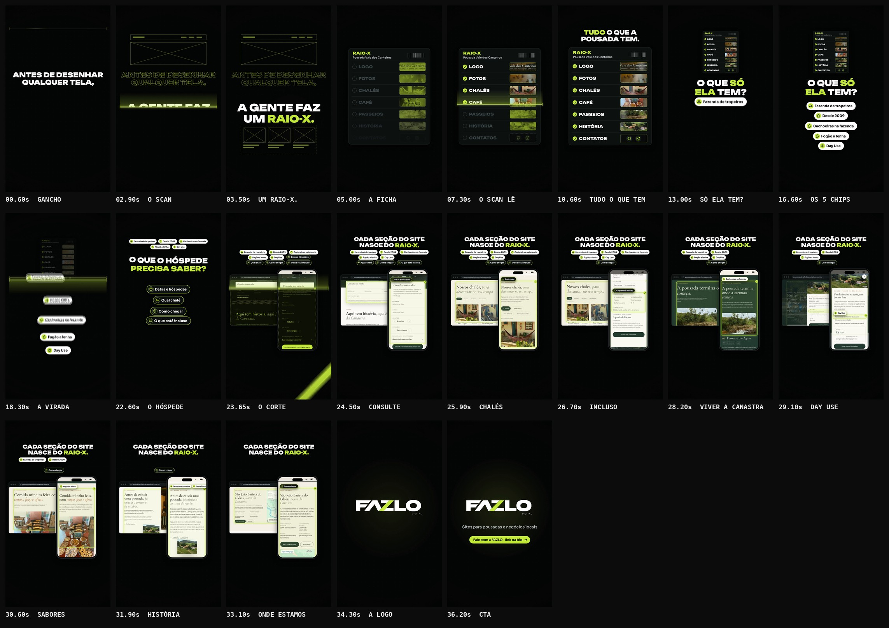

# FAZLO Digital — "Como funciona o raio-x"

Reel da @fazlodigital (pasta `como-funciona-o-raio-x`, nomeada pelo título). Usa a mesma identidade, o mesmo motor e a mesma linguagem de trilha do Reel "Instagram não é site".

**Formato:** 9:16 (1080×1920), **36,6 s**, 60 fps, H.264 + AAC 48 kHz, áudio em −14 LUFS. 100% motion graphics: sem avatar, sem pessoa, sem cenário real. As telas do site são **capturas reais** do site da Pousada Vale dos Canteiros, com uso autorizado pelo cliente.

▶ **Vídeo:** [`output/fazlo-digital-como-funciona-o-raio-x.mp4`](output/fazlo-digital-como-funciona-o-raio-x.mp4)
🖼 **Capa:** [`output/capa.png`](output/capa.png) · Storyboard: [`output/storyboard.jpg`](output/storyboard.jpg) · Revisão: [`output/revisao/`](output/revisao)



---

## Conceito: a linha de scan

O gesto central é uma **linha de scan lima**, horizontal e com brilho.

- **O que ela atravessa vira raio-x:** contorno lima, negativo da imagem e a planta da página, com as caixas de seções, fotos e títulos medidas na captura.
- **Na virada, faz o caminho inverso:** passa pelo celular e pelo navegador em raio-x e revela o **site real** por trás.

A mensagem: antes de desenhar qualquer tela, a FAZLO faz um raio-x da pousada, e cada seção do site nasce dele.

## Roteiro (100 BPM · 1 tempo = 0,6 s)

| Tempo | Cena | O que acontece |
|---|---|---|
| 0–4,2 s | **Gancho** | **ANTES DE DESENHAR / QUALQUER TELA,** sobe palavra por palavra e fica parado para leitura. Em 2,4 s a linha de scan desce de cima a baixo. Acima dela a frase vira contorno e aparece a planta de um site. **A GENTE FAZ / UM RAIO-X.** é revelada pela linha, e "RAIO-X." em lima recebe o golpe em 3,0 s. |
| 4,2–12,0 s | **A coleta** | A frase vira o rótulo de uma ficha escura: "RAIO-X · Pousada Vale dos Canteiros". De 5,4 s a 9,0 s o scan desce e acende um item por tempo: **LOGO · FOTOS · CHALÉS · CAFÉ · PASSEIOS · HISTÓRIA · CONTATOS**. Cada miniatura passa de raio-x a **recorte real** do site, e CONTATOS mostra só ícones, sem nomes nem números. **TUDO O QUE A POUSADA TEM.** |
| 12,0–18,0 s | **O que é único** | A ficha recua para o alto e o scan a "filtra". **O QUE SÓ ELA TEM?** Um chip cheio por tempo sai da ficha: "Fazenda de tropeiros" · "Desde 2009" · "Cachoeiras na fazenda" · "Fogão a lenha" · "Day Use". |
| 18,0–23,4 s | **O que o hóspede precisa saber** | O scan sobe e os chips vão para uma bandeja no alto. **O QUE O HÓSPEDE PRECISA SABER?** Entram 4 chips de contorno lima: "Datas e hóspedes" · "Qual chalé" · "Como chegar" · "O que está incluso". |
| 23,4–33,6 s | **Do raio-x ao site** | "O corte" da assinatura: a barra lima varre e o navegador e o celular aparecem em raio-x. O scan passa e revela o **site real**. **CADA SEÇÃO DO SITE / NASCE DO RAIO-X.** Cada chip voa da bandeja até o celular, a página rola até a seção e a seção **acende** (contorno lima e ✓), com o chip preso como etiqueta. O navegador acende a mesma seção na versão desktop. A ordem está na tabela abaixo. |
| 33,6–36,6 s | **Fechamento** | Logo **FAZLO DIGITAL** centralizada (SVG do kit, montada pelas formas, 720 px), **Sites para pousadas e negócios locais** e a pílula lima **Fale com a FAZLO · link na bio**. |

### Os 7 encaixes da cena 5

| Instante | Chip | Seção do site |
|---|---|---|
| 24,0 s | "Datas e hóspedes" | "Consulte sua estadia" |
| 25,45 s | "Qual chalé" | "Nossos chalés" |
| 26,35 s | "O que está incluso" | modal "Ver detalhes" do chalé: Comodidades e Alimentação |
| 27,8 s | "Cachoeiras na fazenda" | "Viver a Canastra" |
| 28,75 s | "Day Use" | modal do Day Use: "Acesso às 04 cachoeiras da pousada" |
| 30,2 s | "Fogão a lenha" | "Sabores da fazenda" |
| 31,4 s | "Fazenda de tropeiros" + "Desde 2009" | "Nossa história" |
| 32,7 s | "Como chegar" | "Onde estamos", com o mapa |

**Ajuste de tempo:** o roteiro aprovado estendia a cena 5 em um compasso. Para cada encaixe ter o seu momento, inclusive os dois modais, a cena 5 ficou com 10,2 s. Esse tempo saiu das pausas longas das cenas 3 e 4 (cada uma ainda tem 2,1 a 2,4 s de leitura parada depois do último chip). O total continua em 36,6 s.

## Telas reais e checagem

Capturadas de https://pousadavaledoscanteiros.com.br, com uso autorizado pelo cliente, por [`scripts/capture.cjs`](scripts/capture.cjs) em [`src/assets/site/`](src/assets/site):

- **Celular:** 390 pt em 2x, página inteira em faixas.
- **Desktop:** 1440 px, página inteira em faixas.
- **Telas abertas:** o modal "Ver detalhes" do 1º chalé e o modal do Day Use.
- **`manifest.json`:** guarda a posição de cada seção, foto e título. A rolagem, o destaque e o raio-x usam essas medidas.
- **Depoimentos:** a seção "Quem passou por aqui conta melhor" é **removida da página antes de capturar**. Ela não aparece em nenhuma imagem.
- **Mapa de "Onde estamos" (Google Maps):** a captura de página inteira não desenha iframes de outro domínio, então o mapa é capturado à parte e sobreposto na posição do iframe. Na versão desktop, o cartão do próprio Google mostra a nota da pousada no Maps. É conteúdo do embed oficial, não da seção de depoimentos.
- **Nada inventado:** cada chip, item da ficha e seção foi conferido no site ao vivo, com o trecho onde aparece, em [`checagem.txt`](src/assets/site/checagem.txt). São 21 itens, todos encontrados.
- **Dependências do site:** ele carrega React e Babel do unpkg.com. Como esse domínio está bloqueado na rede do ambiente, a captura usa as mesmas versões tiradas do registro do npm, que são os mesmos arquivos.
- **Visão geral das capturas:** [`output/revisao/capturas.jpg`](output/revisao/capturas.jpg).

## Direção de arte

- **Cores:** fundo `#050606` com grade de pontos que respira, verde-limão `#C6FA41` e branco.
  - O lima marca a linha de scan, o raio-x, as palavras-chave, os ✓ e as seções acesas.
  - O raio-x é o negativo da imagem tingido de lima, com a planta da página por cima.
- **Tipografia (fontes oficiais):** Unbounded 800/900 nos títulos e na ficha; Sora nos textos, chips e na barra do navegador.
- **Chips:**
  - os do "único" são **cheios**: brancos, com ícone em círculo lima;
  - os do hóspede têm **contorno** lima sobre fundo escuro.

  Os ícones são desenhados para o Reel: chapéu de tropeiro, porta, gota, chama, sol, calendário, cama, pin, lista.
- **Dispositivos:**
  - o navegador fica atrás, à esquerda, com a barra de endereço real (`pousadavaledoscanteiros.com.br`);
  - o celular fica à frente, à direita, dentro das zonas seguras;
  - a página nunca para: deriva devagar entre um encaixe e outro.
- **Logo:** SVGs do kit oficial, com 720 px no fechamento e 560 px na capa. O "DIGITAL" fica legível.

## Som

Trilha e efeitos **sintetizados do zero** (numpy/scipy), seguindo os cues da animação (51 eventos). A paleta é a do Reel anterior: 100 BPM, Lá bemol maior.

| Cena | O que toca |
|---|---|
| gancho | pad e vidro esparsos; a **varredura do scanner** (ruído com filtro ressonante e glissando) desce com a linha e cai no golpe de "RAIO-X." |
| a coleta | o groove entra leve; cada item lido soa um **bipe de leitura** afinado, em notas que sobem (pentatônica de Lá bemol) |
| o único | groove mais cheio; o scan "filtra" a ficha; cada chip cheio nasce com um sino |
| o hóspede | o scan sobe; meio-tempo mais seco; cada chip de contorno soa um bloco; uma subida prepara a virada e termina antes do golpe |
| o site | **"o corte"** da assinatura na barra lima; a varredura revela o site; groove completo; cada chip voa (sopro) e encaixa (bloco afinado, escala que sobe); os modais abrem e fecham |
| fechamento | a assinatura completa (varredura + Lá bemol 5 → Mi bemol 6) na logo |

## Capa

[`output/capa.png`](output/capa.png), 1080×1920:

- a logo FAZLO DIGITAL no topo, centralizada (560 px);
- **COMO FUNCIONA O / RAIO-X**, com RAIO-X em lima e grande;
- abaixo, a ficha atravessada pela linha de scan: acima dela, itens lidos (✓ e fotos reais); abaixo, em raio-x.

**Regras do briefing, conferidas no QA:**

- todo o texto fica dentro do recorte 3:4;
- o canto x ≥ 860 / y 240–440 fica livre;
- o rodapé y 1560–1680 fica livre.

## Revisão

Em render: os resultados do QA entram aqui quando o vídeo final estiver pronto.

## Arquivos-fonte

```
reels/como-funciona-o-raio-x/
  reel.json                 # metadados, fontes, assets (capturas), QA, storyboard
  src/anim.js               # roteiro: scan, ficha, chips, site real (celular + navegador), logo, capa, cues
  src/assets/site/          # capturas reais, manifest.json (posições) e checagem.txt
  scripts/capture.cjs       # captura do site ao vivo + checagem dos dados (+ assets no reel.json)
  scripts/capturas_folha.py # folha de revisão das capturas
  scripts/audio.py          # trilha e efeitos por cue, master
  audio/cues.json           # 51 eventos de som exportados da animação
  audio/trilha.wav
  output/                   # vídeo, capa, storyboard, revisão
```

### Comandos (na raiz do repositório)

```bash
node reels/como-funciona-o-raio-x/scripts/capture.cjs        # recaptura o site e refaz a checagem
python3 reels/como-funciona-o-raio-x/scripts/capturas_folha.py
npm run build -- como-funciona-o-raio-x                      # cues -> áudio -> vídeo -> capa -> storyboard -> QA
npm run dev                                                  # preview: /core/player.html?reel=como-funciona-o-raio-x
```
