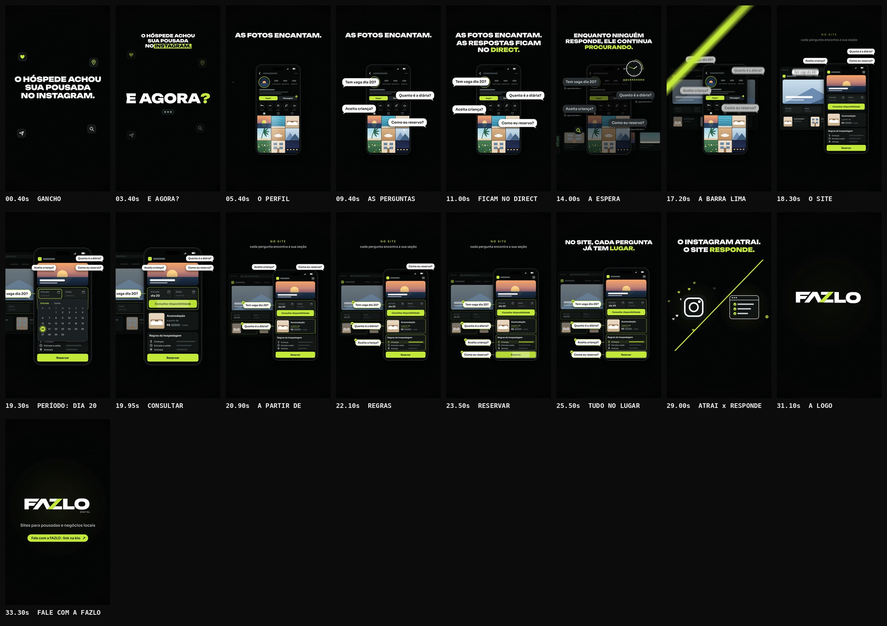

# FAZLO Digital — "Instagram não é site"

Reel da @fazlodigital (pasta `instagram-nao-e-site`, nomeada pelo título), independente dos Reels 00, 001, 002 e 003.

**Formato:** 9:16 (1080×1920), **33,6 s**, 60 fps, H.264 + AAC 48 kHz, áudio em −14 LUFS. 100% motion graphics: sem avatar, sem pessoa, sem cenário real.

▶ **Vídeo:** [`output/fazlo-digital-instagram-nao-e-site.mp4`](output/fazlo-digital-instagram-nao-e-site.mp4)
🖼 **Capa:** [`output/capa.png`](output/capa.png) · Storyboard: [`output/storyboard.jpg`](output/storyboard.jpg) · Revisão: [`output/revisao/`](output/revisao)



---

## Conceito

O hóspede encontra a pousada no Instagram, se encanta com as fotos e fica com as perguntas paradas no direct. No site, cada pergunta já tem um lugar para ser respondida.

**Assinatura visual da @fazlodigital: telas de site** no celular e no navegador. As interfaces são ilustrativas e genéricas:

- nenhuma pousada real e nenhum nome de cliente;
- nenhum número inventado: nomes, contadores e preços são barras neutras;
- o único dado é o "dia 20", que vem da própria pergunta do hóspede.

**Ritmo:** animação → pausa para compreensão → transição. Cada frase fica na tela tempo suficiente para ser lida. Chips, balões, ícones e selos têm micro-animações contínuas.

## Roteiro (100 BPM · 1 tempo = 0,6 s)

| Tempo | Cena | O que acontece |
|---|---|---|
| 0–4,2 s | **Gancho** | **O HÓSPEDE ACHOU / SUA POUSADA / NO INSTAGRAM.** sobe palavra por palavra, com chips flutuantes (coração, localização, avião, busca). Pausa. O bloco sobe e, no golpe (3,0 s), entra **E AGORA?** grande; a música para. |
| 4,2–12,0 s | **Perguntas** | Um celular com um perfil genérico do Instagram: grade de 9 "fotos" ilustradas, corações e o ponto lima do direct. Os balões chegam um a um, cada um com o ping de mensagem: "Tem vaga dia 20?", "Quanto é a diária?", "Aceita criança?", "Como eu reservo?". **AS FOTOS ENCANTAM.** · **AS RESPOSTAS FICAM NO DIRECT.** |
| 12,0–16,8 s | **Espera** | Os balões ficam cinza e parados, com "aguardando" e reticências. Um relógio grande gira (**AGUARDANDO**) e o perfil escurece. **ENQUANTO NINGUÉM RESPONDE, ELE CONTINUA PROCURANDO.** |
| 16,8–27,0 s | **Virada** | A barra lima da marca varre na diagonal e o celular vira **site**, com a versão de navegador ao lado. Os balões sobem para uma fila e cada um voa em arco até a seção que o responde (ver abaixo). **NO SITE, CADA PERGUNTA JÁ TEM LUGAR.** |
| 27,0–30,6 s | **Síntese** | A barra divide a tela. À esquerda, o ícone do Instagram atrai corações; à direita, o ícone de site solta selos ✓. **O INSTAGRAM ATRAI. O SITE RESPONDE.** |
| 30,6–33,6 s | **Fechamento** | A logo **FAZLO DIGITAL** se monta pelas formas do SVG oficial: as letras sobem, a barra corta e DIGITAL entra. Depois vêm **Sites para pousadas e negócios locais** e a pílula lima **Fale com a FAZLO · link na bio**, que fica 1,7 s na tela. |

### O fluxo do site: período → consultar → reserva

| Instante | Balão | Seção que responde |
|---|---|---|
| 18,6 s | "Tem vaga dia 20?" | **Consultar disponibilidade**: só os campos Entrada e Saída e o botão, sem calendário aberto na página. A câmera aproxima e um **seletor compacto de período** abre (entrada e saída no mesmo calendário). O **dia 20** acende, o campo Entrada recebe "dia 20", o seletor fecha e o botão "Consultar disponibilidade" é pressionado (19,8 s). |
| 20,7 s | "Quanto é a diária?" | card **Acomodação · a partir de R$ ▬ / noite**: o valor é uma barra, não um número |
| 21,9 s | "Aceita criança?" | **Regras da hospedagem**: Crianças, Entrada e saída, Animais |
| 23,1 s | "Como eu reservo?" | botão **Reservar**, tocado em 23,4 s. Uma linha lima tracejada liga Consultar a Reservar e fecha o fluxo. |

Cada balão encaixado ganha borda lima e um selo ✓ que respira. O navegador ao lado mostra a mesma página na versão desktop: barra de endereço com cadeado (sem domínio), foto principal com movimento lento, barra de disponibilidade e cards.

## Direção de arte

- **Cores:** fundo preto `#050606` (com uma grade de pontos que respira), verde-limão oficial **`#C6FA41`** e branco. O lima marca o que resolve: a palavra-chave de cada frase, o dia 20, os botões, os selos.
- **Tipografia (fontes oficiais da FAZLO Digital):**
  - **Unbounded** 800/900 nos títulos (usada onde o roteiro pedia Archivo Expanded Black);
  - **Sora** nos textos e nas telas (usada onde o roteiro pedia Inter).
- **Logo:** os SVGs do kit oficial (`brand/logo/kit/`) são lidos e animados pelas próprias formas (letras, barra lima, DIGITAL), sem redesenho. A capa usa a mesma logo montada.
- **Gesto da marca:** a barra lima com a inclinação da logo (dx/dy = −0,966) faz a virada e divide a síntese.
- **Movimento:**
  - os títulos sobem em fendas, palavra por palavra;
  - balões e chips entram com mola;
  - a câmera aproxima no seletor de período;
  - o site deriva devagar durante a virada;
  - tudo tem motion blur real, mais forte nas passagens rápidas.
- **Pós:** vinheta e grão leves.

## Som

Trilha e efeitos **sintetizados do zero** (numpy/scipy), seguindo os cues da animação (32 eventos). 100 BPM, Lá bemol maior, com a espera em Fá menor.

| Cena | O que toca |
|---|---|
| gancho | arpejo de vidro leve; em "E AGORA?" a música para e só fica o "digitando…" |
| perguntas | groove leve (bumbo, palmas, chimbal, baixo, piano FM); cada balão chega com um ping de mensagem de duas notas |
| espera | a música trava como fita parando; ficam o tique-taque do relógio, um pad e um pulso abafado; uma subida prepara a virada |
| virada | **"o corte"** da assinatura quando a barra varre; o groove volta mais claro. Cada balão voa com um sopro e encaixa com um bloco afinado que sobe (Lá bemol, Dó, Mi bemol, Lá bemol). Seletor, dia 20, Consultar e Reservar têm sons de interface. |
| síntese | impacto e o acorde abre |
| fechamento | a assinatura completa (varredura + Lá bemol 5 → Mi bemol 6) na logo |

**Master:** −14 LUFS; pico real −1,8 dBTP no MP4. Os golpes principais têm um respiro de 60 ms antes, e os impactos têm ataque de 3 ms para o AAC não passar do limite.

## Capa

[`output/capa.png`](output/capa.png), 1080×1920:

- a logo no topo, centralizada;
- o título **INSTAGRAM / NÃO É / SITE**, com SITE em lima;
- abaixo, os balões cinza do direct → seta → um card de site com ✓.

**Regras do briefing, conferidas no QA:**

- todo o texto fica dentro do recorte 3:4 (y 240–1680);
- o canto superior direito fica livre (x ≥ 860, y 240–440);
- o rodapé fica livre (y 1560–1680);
- nada é cortado.

Veja [`capa-no-feed.jpg`](output/revisao/capa-no-feed.jpg).

## Revisão

`npm run qa -- instagram-nao-e-site` gera [`relatorio-tecnico.txt`](output/revisao/relatorio-tecnico.txt), [`sincronia.txt`](output/revisao/sincronia.txt), [`zonas-seguras.jpg`](output/revisao/zonas-seguras.jpg) e [`capa-no-feed.jpg`](output/revisao/capa-no-feed.jpg).

**Técnica (aprovada):**

- 1080×1920, 60 fps, 2.016 quadros, 11,6 MB;
- H.264 High yuv420p, AAC 48 kHz estéreo;
- 33,600 s de vídeo e de áudio (Δ 0 ms);
- **−14,1 LUFS** e pico real **−1,8 dBTP**;
- sem trechos pretos nem imagem congelada; o 1º quadro já tem imagem;
- capa 1080×1920, com as áreas livres respeitadas e o conteúdo dentro do recorte 3:4.

**Sincronização (aprovada):**

1. o áudio do MP4 é a trilha, sem deslocamento (0,0 ms);
2. os 3 golpes-chave caem no instante do evento visual, com **desvio médio de 6,8 ms e máximo de 9,3 ms**: E AGORA?, a barra e a logo;
3. a imagem reage nos 4 golpes principais (E AGORA?, a barra, a divisão da síntese, a logo).

**Legibilidade e zonas seguras:** todo texto fica fora das áreas cobertas pela interface do Reels: topo, rodapé e coluna de botões à direita. Os balões vão para uma fila no alto da tela antes de voar, e essa fila fica abaixo da zona do topo e fora do zoom da câmera.

**Ajustes feitos na revisão:**

- **Abertura:** o gancho começa um pouco antes de 0 s, então o 1º quadro já mostra texto e chips.
- **Subida do gancho:** ficava com rastro. O movimento ficou mais lento e ganhou mais amostras de motion blur.
- **Seletor de período:** os balões esperando cobriam o seletor durante o zoom. Agora eles esperam numa fila no alto, desenhada fora da câmera, e o rótulo "NO SITE" sai durante o zoom.
- **Síntese → logo:** os ícones encolhem no lugar, e os títulos saem enquanto a logo se monta. Antes, a tela ficava quase vazia por um instante e o QA lia isso como trecho preto.
- **Imagem congelada (24,7–27 s):** o site ganhou deriva contínua, as fotos principais ganharam movimento lento e os selos respiram.
- **Áudio:**
  - a espera era quase só subgrave e ganhou pad mais claro e relógio mais presente;
  - o golpe da logo passava de 0 dBTP depois do AAC, então os impactos e o corte foram suavizados e o limitador ganhou folga.

## Arquivos-fonte

```
reels/instagram-nao-e-site/
  reel.json            # metadados, fontes, QA (áreas livres da capa), storyboard
  src/anim.js          # roteiro: perfil, balões, espera, site (celular + navegador), seletor, síntese, logo, capa, cues
  scripts/audio.py     # trilha e efeitos por cue, master
  audio/cues.json      # 32 eventos de som exportados da animação
  audio/trilha.wav
  output/              # vídeo, capa, storyboard, revisão
```

### Como renderizar (na raiz do repositório)

```bash
npm run build -- instagram-nao-e-site                  # cues -> áudio -> vídeo -> capa -> storyboard -> QA
npm run dev                                            # preview: /core/player.html?reel=instagram-nao-e-site
npm run stills -- instagram-nao-e-site 3.4,19.3,23.5   # quadros avulsos em PNG
```
