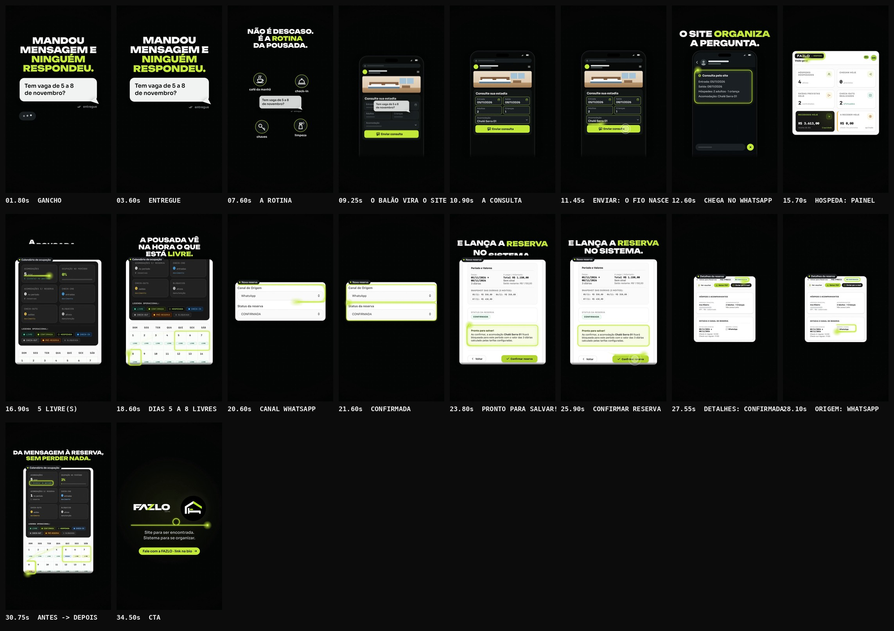

# FAZLO Digital + FAZLO Hospeda (collab) — "Mandou mensagem e ninguém respondeu"

Reel da collab @fazlodigital + @fazlohospeda (pasta `mandou-mensagem`). Usa a mesma identidade, o mesmo motor e a mesma linguagem de trilha dos Reels da FAZLO Digital.

**Status: concluído · em avaliação.**

**Formato:** 9:16 (1080×1920), **35,4 s**, 60 fps, H.264 + AAC 48 kHz, áudio em −14 LUFS. 100% motion graphics.

▶ **Vídeo:** [`output/fazlo-digital-mandou-mensagem.mp4`](output/fazlo-digital-mandou-mensagem.mp4)
🖼 **Capa:** [`output/capa.png`](output/capa.png) · Storyboard: [`output/storyboard.jpg`](output/storyboard.jpg) · Revisão: [`output/revisao/`](output/revisao)



> **Exceção da collab:** a FAZLO Digital tem identidade própria e não reutiliza nada do FAZLO Hospeda. Este Reel é a exceção combinada para a collab: mostra os prints reais do sistema Hospeda e a marca do Hospeda no CTA. Nada foi buscado no repositório do Hospeda.

---

## Conceito: o fio

Um **fio lima** conecta as duas pontas. Ele nasce na consulta do site, passa pelo WhatsApp e termina na reserva registrada no Hospeda: é a própria mensagem viajando sem se perder. Em cada ponto importante, o fio dá uma volta e fecha um contorno, que fica enquanto aquela tela estiver à vista. No CTA, ele liga as duas marcas.

**Regra de honestidade:** o site não envia a reserva para o Hospeda. O fluxo mostrado é o real: consulta pelo site → chega no WhatsApp → a pousada confere a ocupação no Hospeda → lança a reserva à mão (escolhendo o canal WhatsApp) → reserva registrada. Quem confirma é a pousada (o toque em "Confirmar reserva"); nenhum texto diz "automático", "integrado" ou "sozinho".

## Roteiro (100 BPM · 1 tempo = 0,6 s · 59 tempos)

| Tempo | Cena | O que acontece |
|---|---|---|
| 0–4,2 s | **Gancho** | O balão do hóspede já está na tela: **"Tem vaga de 5 a 8 de novembro?"**, com dois checks cinza e **"entregue"** (sem "visto"). O "…" da pousada aparece (1,2–2,7 s) e some, sem resposta. **MANDOU / MENSAGEM E / NINGUÉM / RESPONDEU.**, com "NINGUÉM RESPONDEU." em lima, e aproximação lenta. |
| 4,2–9,0 s | **A rotina** | O balão fica parado, menor. Um ícone por tempo surge em volta, com legenda: **café da manhã** (4,8), **check-in** (5,4), **limpeza** (6,0), **chaves** (6,6). **NÃO É DESCASO. / É A ROTINA / DA POUSADA.**, com "ROTINA" em lima. |
| 9,0–15,0 s | **O site organiza** | O celular sobe com um **site genérico** (sem nome de pousada) e o balão voa para dentro do formulário: a pergunta solta vira campos. Um campo por tempo: **Entrada 05/11/2026 · Saída 08/11/2026** (9,6), **2 adultos · 1 criança** (10,2), **Chalé Serra 01** (10,8). Toque em **"Enviar consulta"** (11,4): **o fio nasce**. A conversa recriada (ícone genérico, avatar em silhueta, sem número) recebe a mensagem organizada (12,0) e o fio a contorna. **O SITE ORGANIZA / A PERGUNTA.** |
| 15,0–27,0 s | **O Hospeda organiza** | **Painel (01):** só os cards do topo; o fio contorna a marca do app. **Calendário antes (02):** o fio contorna **"5 livre(s) no período"**, a tela rola até a grade e ele contorna **os dias 5 a 8, LIVRE**. **A POUSADA VÊ / NA HORA O QUE / ESTÁ LIVRE.** **Etapa 4 (03):** **Canal de Origem: WhatsApp** e **Status: CONFIRMADA**. **Revisão (04):** **"Pronto para salvar!"** e o toque da pousada em **"Confirmar reserva"** (25,8). **E LANÇA A RESERVA / NO SISTEMA.** |
| 27,0–31,2 s | **O ciclo fecha** | **Detalhes (05), sem zoom:** o fio contorna o selo **CONFIRMADA** (reserva FHZ-F9B2I2) e **"Origem / Canal: WhatsApp"**. **Antes → depois:** o calendário 02 volta com o mesmo enquadramento e, em 29,4 s, uma faixa lima varre a tela e revela o 06: **"4 livre(s) no período"**, dia **5 CHEGADA**, **6 e 7 reservados** (1 RES), **8 SAÍDA**; o fio contorna cada um. **DA MENSAGEM À RESERVA, / SEM PERDER NADA.** |
| 31,2–35,4 s | **CTA** | A barra lima da logo ("o corte") varre a tela. **FAZLO DIGITAL** (SVG do kit) e a **logo oficial do FAZLO Hospeda** (o círculo com a casa e a cama) lado a lado, ligadas pelo fio, com um laço entre elas. **Site para ser encontrada. / Sistema para se organizar.** e a pílula lima **Fale com a FAZLO · link na bio**. |

## Telas do Hospeda: só os prints reais

- **Recortes**, não originais: chegaram com 860–1290 px de largura. Os arquivos recebidos **não são versionados**; [`scripts/prints.py`](scripts/prints.py) grava em [`src/assets/hospeda/`](src/assets/hospeda) só as versões tratadas.
- **Reserva mostrada:** FHZ-F9B2I2 · Chalé Serra 01 · 05/11 → 08/11/2026 · 3 diárias · R$ 1.150,00 · canal WhatsApp · CONFIRMADA. O site e a conversa usam os mesmos dados.
- **Telefone do hóspede:** já veio coberto por uma barra neutra nos recortes 04 e 05 (o mesmo padrão de "valores em barras"). O número não existe em nenhum arquivo do repositório.
- **Painel (01):** só os cards do topo; nada abaixo deles (nomes de teste não aparecem).
- **Detalhes (05):** sem zoom (na largura da tela do celular), para não dar destaque a "1 Crianças".
- **Antes e depois (02 → 06):** o 06 foi alinhado ao 02 pelo conteúdo (bloco escuro de indicadores, escala 1,582); a grade bate a menos de 3 px, então só mudam os valores.
- **Apresentação:** os recortes aparecem como **cartões ampliados** (~1,4× a tela do celular, o zoom aprovado), com o título real da tela numa etiqueta ("Calendário de ocupação", "Nova reserva", "Detalhes da reserva"). Cada cartão entra opaco, de baixo, por cima do anterior.
- **Nada inventado:** nenhuma tela, botão, função ou aviso de sucesso; o único toque no Hospeda é em "Confirmar reserva".
- **Logo do FAZLO Hospeda:** a oficial, enviada pela @fazlohospeda. O desenho (casa e cama) é usado como veio; só o círculo preto foi redesenhado liso, porque o arquivo tem a borda serrilhada. No CTA, um brilho branco suave atrás dela separa o círculo preto do fundo escuro.

## Direção de arte

- **Cores:** fundo `#050606` com grade de pontos que respira, verde-limão `#C6FA41` e branco. O lima é do fio, dos contornos e das palavras-chave.
- **Tipografia:** Unbounded 900 nos títulos; Sora no balão, nas legendas, no site e na conversa.
- **Celular (cena 3):** o mesmo do "Site não é luxo" (660 px, x 210–870), que some antes de y 1560. Os títulos ficam acima, na faixa y 240–436.
- **O fio:** linha lima de ~6 px com brilho e uma cabeça luminosa; o rastro se apaga atrás dela; nas viagens, faz uma curva suave entre um alvo e outro.

## Som

Trilha e efeitos **sintetizados do zero** (numpy/scipy), seguindo os cues da animação (55 eventos). Mesma paleta: 100 BPM, Lá bemol maior.

| Cena | O que toca |
|---|---|
| gancho | pad, baixo e vidro esparsos, pulsação grave leve; o "pop" do envio; os cliques do "…" que param e deixam uma nota suspensa |
| rotina | groove leve; um som por ícone: xícara no pires, campainha de recepção, borrifador, chaves |
| site | o groove firma; um bloco afinado por campo, em notas que sobem; toque em "Enviar"; o fio nasce com um zíper que sobe; notificação genérica (não é o som do WhatsApp) |
| Hospeda | groove completo e arpejo; o fio desliza entre os alvos (glissando) e cada contorno soa um bloco afinado, em escala que sobe; sopro nas trocas e rolagens; respiro de 60 ms, toque e acorde em "Confirmar reserva" |
| ciclo | varredura e sinos na troca antes → depois |
| CTA | a assinatura completa (varredura + Lá bemol 5 → Mi bemol 6) nas logos; o fio ligando as marcas |

## Capa

[`output/capa.png`](output/capa.png), 1080×1920: logo FAZLO DIGITAL no topo (560 px); **MANDOU / MENSAGEM E / NINGUÉM / RESPONDEU**, com "NINGUÉM RESPONDEU" em lima; o balão "Tem vaga de 5 a 8 de novembro?" com dois checks cinza e "entregue", e o balão de reticências embaixo. Texto dentro do recorte 3:4, canto x ≥ 860 / y 240–440 livre, rodapé y 1560–1680 livre, nada cortado.

## Revisão

`npm run qa -- mandou-mensagem` gera [`relatorio-tecnico.txt`](output/revisao/relatorio-tecnico.txt), [`sincronia.txt`](output/revisao/sincronia.txt), [`zonas-seguras.jpg`](output/revisao/zonas-seguras.jpg) e [`capa-no-feed.jpg`](output/revisao/capa-no-feed.jpg). A folha de teste das cenas 1–5 está em [`teste-cenas-1-a-5.jpg`](output/revisao/teste-cenas-1-a-5.jpg).

**Técnica (aprovada):** 1080×1920, 60 fps, 2.124 quadros, 14,5 MB; H.264 High yuv420p, AAC 48 kHz estéreo; 35,400 s de vídeo e de áudio (Δ 0 ms); **−14,0 LUFS** e pico real **−2,7 dBTP**; sem trechos pretos nem imagem congelada; o 1º quadro já tem imagem; capa com as áreas livres e o recorte 3:4 respeitados.

**Sincronização (aprovada):** o áudio do MP4 é a trilha, sem deslocamento; os 8 efeitos-chave (3 campos, "Enviar", a notificação, "Confirmar reserva", a troca antes → depois e a logo) caem no instante do evento visual, com **desvio máximo de 6,8 ms**; a imagem reage nos 3 golpes principais (notificação, antes → depois e logo).

**Ajustes feitos na revisão:**

- **"entregue" no lugar de "visto"** (gancho e capa): "visto e não respondeu" passaria descaso, o contrário da cena 2.
- **Recortes da sessão certa da demo:** os primeiros recortes eram de outra sessão ("Chalé do Chaves", 1 acomodação) e foram descartados; os 04 e 05 seguintes mostravam outra reserva (05 → 11/11, R$ 2.300,00) e também não foram usados.
- **Transições dos recortes:** o cartão novo entra opaco por cima do anterior, e os contornos do cartão que sai somem na hora (antes, os dois cartões ficavam meio transparentes um sobre o outro).
- **Imagem congelada:** o QA acusou a pausa da conversa (12,98 s); o celular passou a respirar devagar (±7 px).
- **Antes → depois:** como só os valores mudam, a troca quase não mexia a imagem; agora uma faixa lima varre o cartão junto com o fio.
- **Logo oficial no CTA:** substituiu a marca "FAZLO | HOSPEDA" recortada do app, usada até a logo chegar.

## Arquivos-fonte

```
reels/mandou-mensagem/
  reel.json                # metadados, fontes, assets (recortes tratados), QA, storyboard
  src/anim.js              # balão, rotina, site e conversa recriados, cartões do Hospeda, o fio, CTA, capa, cues
  src/assets/hospeda/      # recortes tratados (01–06), a logo oficial do Hospeda e manifest.json
  scripts/prints.py        # recebidos -> assets (telefone coberto se vier à vista; 06 alinhado ao 02; círculo da logo liso)
  scripts/audio.py         # trilha e efeitos por cue, master
  audio/cues.json          # 55 eventos de som exportados da animação
  audio/trilha.wav
  output/                  # vídeo, capa, storyboard, revisão
```

### Comandos (na raiz do repositório)

```bash
python3 reels/mandou-mensagem/scripts/prints.py <pasta-dos-recortes>   # recortes -> src/assets/hospeda/
npm run build -- mandou-mensagem                                      # cues -> áudio -> vídeo -> capa -> storyboard -> QA
npm run dev                                                           # preview: /core/player.html?reel=mandou-mensagem
```
