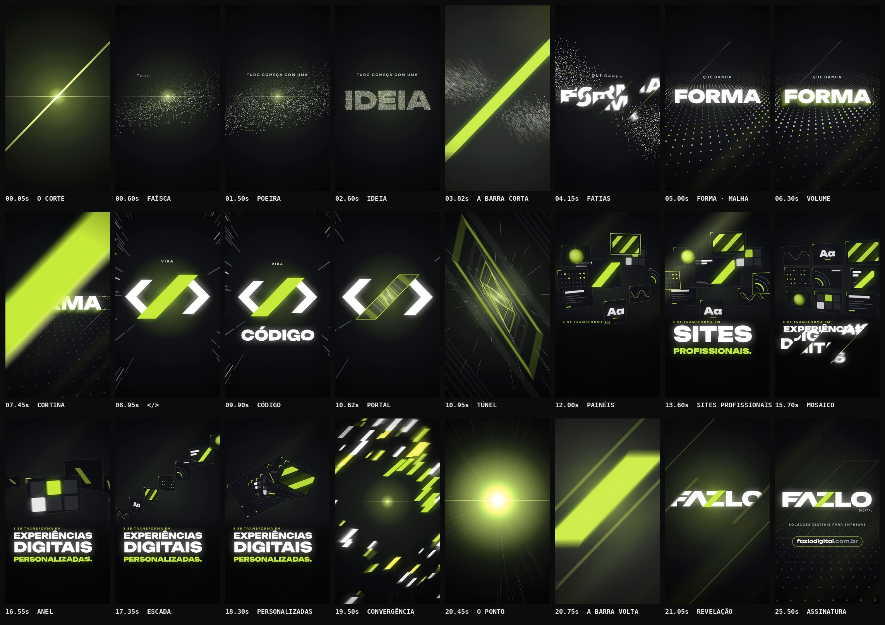

# FAZLO Digital — Reel 00 · Apresentação oficial · "Da ideia ao digital."

Primeira produção oficial de motion graphics da FAZLO Digital: a apresentação da marca.

**Formato:** 9:16 (1080×1920), **26,8 s**, 60 fps, H.264 + AAC 48 kHz, áudio em −14 LUFS.

▶ **Vídeo:** [`output/fazlo-digital-reel-00.mp4`](output/fazlo-digital-reel-00.mp4)
🖼 **Capa:** [`output/capa.png`](output/capa.png) · Storyboard: [`output/storyboard.jpg`](output/storyboard.jpg) · Revisão: [`output/revisao/`](output/revisao)



---

## Conceito: o traço que transforma

A logo da FAZLO Digital tem um gesto único: a diagonal do "Z" é uma **barra verde-lima** que corta as letras brancas. O Reel faz dessa barra a protagonista. Ela é o **corte** que transforma uma ideia solta em algo concreto. Ao longo do vídeo, a barra organiza a poeira em forma, vira a barra do `</>` do código, abre um portal e, no fim, **volta exatamente ao seu lugar na logo**.

A narrativa é uma única frase, escrita ao longo das cenas:

> **Tudo começa com uma IDEIA · que ganha FORMA · vira CÓDIGO · e se transforma em SITES PROFISSIONAIS · EXPERIÊNCIAS DIGITAIS PERSONALIZADAS.** → FAZLO Digital · Soluções digitais para empresas · fazlodigital.com.br

**Conteúdo (somente informação verificada).** O site oficial não pôde ser consultado: o domínio está bloqueado pela política de rede do ambiente de produção e não aparece em buscas. Por isso o texto usa **apenas** o que veio no briefing:

- soluções digitais para empresas;
- sites profissionais;
- experiências digitais personalizadas;
- o endereço fazlodigital.com.br.

Não há serviços, números, clientes ou resultados inventados. "Ideia → forma → código" é a metáfora criativa do processo, não uma lista de serviços. O título "Da ideia ao digital." é o mote da campanha e aparece só na capa.

## Roteiro (128 BPM · 1 compasso = 1,875 s)

| Tempo | Compasso | Cena | O que acontece |
|---|---|---|---|
| 0–3,75 s | 1–2 | **Faísca · IDEIA** | O 1º quadro já é um corte: uma lâmina lima atravessa a tela na inclinação da barra e se recolhe numa faísca. Cerca de 2.100 partículas orbitam a faísca num vórtice e, da esquerda para a direita, pousam formando **IDEIA**. Sobre ela entra "TUDO COMEÇA COM UMA". No fim do c.2 as partículas tremem cada vez mais, a tela se contrai e um rolo de caixa leva ao drop. |
| 3,75–7,5 s | 3–4 | **O corte · FORMA** | **Drop:** a barra gigante atravessa a palavra, e a poeira explode para os dois lados do corte e pousa numa **malha 3D**, um piso de pontos que pulsa a cada tempo. **FORMA** entra em 7 fatias que deslizam pelos trilhos diagonais. Guias de construção se desenham a cada tempo; no c.4 a palavra ganha **volume**, extrudada na inclinação da barra, e um brilho a percorre. |
| 7,5–11,25 s | 5–6 | **CÓDIGO · portal** | Uma cortina lima diagonal troca a cena. Entre paredes de "código" abstrato, `<` e `>` chegam girando nos tempos 2 e 3, e a barra cai no 4 formando **`</>`**, com a barra da logo no lugar da barra do código. "CÓDIGO" entra no c.6, com glitches em semicolcheias. No tempo 3 a câmera **mergulha na barra**, que vira um portal para um túnel de molduras na forma da barra. |
| 11,25–15 s | 7–8 | **SITES PROFISSIONAIS** | Saída do túnel com clarão. Nove painéis (composições gráficas abstratas, sem telas nem interface) voam do fundo em semicolcheias e montam uma composição em camadas, com a câmera em órbita. **SITES / PROFISSIONAIS.** em bloco justificado; no c.8 um painel acende a cada tempo e uma faixa de luz varre o conjunto. |
| 15–18,75 s | 9–10 | **EXPERIÊNCIAS DIGITAIS PERSONALIZADAS** | Os **mesmos** painéis se reorganizam a cada 2 tempos: mosaico → anel girando → escada → baralho. Cada giro completo revela um conteúdo novo, a ideia de "personalizado" mostrada pela imagem. Cada giro tem um soco de câmera e um clarão curto. |
| 18,75–20,6 s | 11 | **Convergência** | Os painéis abrem para fora, viram barras lima e espiralam para o centro com um enxame de barras, poeira e linhas de velocidade. Tudo colapsa num único ponto de luz (a faísca do início). |
| 20,6–26,8 s | 12–14 | **A marca** | **Impacto:** a barra chega gigante e encolhe até o lugar exato da barra da logo. A **logo oficial** se revela a partir dela, em duas faixas diagonais que se abrem para os lados, e recebe um brilho especular. Em seguida entram "SOLUÇÕES DIGITAIS PARA EMPRESAS" e **fazlodigital.com.br**, com uma moldura lima que se desenha em volta. Ondas na forma da barra pulsam com o groove até o fim. |

## Direção de arte

- **Paleta (da logo oficial):** verde-lima `#C5FA40` (amostrado da barra), branco e um preto profundo levemente frio (`#050506`) como palco, com profundidade dada por gradientes e luz. Tokens em [`brand/tokens.js`](../../brand/tokens.js).
- **Tipografia:** **Unbounded** nos títulos (sans larga e pesada, em diálogo com o desenho da logo) e **Sora** nos apoios, ambas sob licença OFL e em [`brand/fonts/`](../../brand/fonts).
- **Sistema gráfico:**
  - Tudo obedece à **inclinação da barra** (lados com dx/dy = −0,966, ≈ 46°, medidos na logo): fatias de texto, cortina, feixes de luz, guias, chevrons, túnel, ondas finais e capa.
  - O **texto fatiado** é a assinatura cinética da marca: cada palavra entra em fatias diagonais que deslizam pelos próprios trilhos e travam, com um fio de luz no trilho em movimento.
- **Profundidade:** projeção 3D real, calculada a cada quadro, para a malha de pontos, as paredes de código, o túnel e os painéis em órbita. O conteúdo dos painéis é mapeado na perspectiva.
- **Logo:** sempre o **arquivo oficial**, nunca redesenhado. A animação usa só máscara (revelação diagonal), escala e brilho por cima. A barra animada tem a geometria medida na logo e, ao pousar, coincide com a barra do arquivo.
- **Sem prints, telas, celulares ou interfaces:** os painéis são composições gráficas abstratas.
- **Acabamento:**
  - **motion blur** real, de 4 a 18 amostras por quadro;
  - **bloom** que preserva o matiz (o lima não "amarela");
  - vinheta e grão de filme determinístico.
- **Zonas seguras:** títulos fora das áreas cobertas pela interface do Reels e longe da coluna de ações.

## Som — identidade sonora da FAZLO Digital

Trilha e efeitos **sintetizados do zero** em Python (numpy/scipy), sem samples.

- **Estilo:** eletrônica cinematográfica a **128 BPM**, Fá menor → Lá bemol maior.
- **Assinatura sonora, "o corte":**
  1. **a varredura:** ruído metálico que sobe de 1,8 a 13 kHz e atravessa o estéreo da esquerda para a direita, como a barra que sobe para a direita;
  2. **o intervalo:** Lá bemol 5 → Mi bemol 6, uma quinta justa em sino FM, a segunda nota uma colcheia depois.
  - Toda barra que corta a tela usa a varredura. A abertura toca só a 1ª nota, que fica "em aberto"; a marca toca a assinatura completa.
- **Arranjo:**
  - faísca com pulso de coração, poeira cintilante e arpejo abrindo o filtro;
  - drop com bumbo reto, baixo em contratempo com sidechain e acordes em supersaw;
  - código com arpejo brilhante e glitches;
  - mergulho sem chão, só subida;
  - convergência com rolo de caixa acelerando e baixo subindo;
  - marca resolvendo em Lá bemol maior, com groove leve até o fim.
- **Sincronia:** a animação exporta `audio/cues.json` (90 eventos) e `scripts/audio.py` coloca cada efeito exatamente nesses instantes.
- **Mix pensado para celular:**
  - subgrave contido e presença reforçada entre 1,5 e 6 kHz;
  - master em **−14 LUFS**, com limitador de pico real: **−1,3 dBTP** no MP4.

## Revisão

`npm run qa -- 00` gera [`relatorio-tecnico.txt`](output/revisao/relatorio-tecnico.txt), [`sincronia.txt`](output/revisao/sincronia.txt), [`zonas-seguras.jpg`](output/revisao/zonas-seguras.jpg) e [`capa-no-feed.jpg`](output/revisao/capa-no-feed.jpg).

**Técnica (aprovada):**

- 1080×1920, 60 fps, 1.608 quadros;
- H.264 High yuv420p, AAC 48 kHz estéreo;
- 26,800 s de vídeo e de áudio;
- **−14,1 LUFS** e pico real **−1,3 dBTP**;
- sem trechos pretos nem imagem congelada; o 1º quadro já tem imagem;
- capa 1080×1920.

**Sincronização (aprovada), em três camadas:**

1. o áudio do MP4 é a trilha, sem deslocamento (0,0 ms);
2. 13 golpes-chave medidos no áudio final caem no instante do evento visual, com **desvio médio de 4,3 ms e máximo de 9,3 ms** (menos de 1 quadro). São eles: o corte de abertura, o drop, as barras, os chevrons, o túnel, os 4 giros e a marca;
3. a imagem reage nos 7 golpes principais.

**Ajustes feitos a partir da revisão quadro a quadro:**

- o bloom aditivo deixava o lima amarelado (medido 255,255,62); agora o bloom preserva o matiz;
- os clarões de tela inteira viravam um véu verde-oliva; agora clareiam em direção ao branco;
- as fatias de texto sumiam no meio do trilho; o trilho foi alongado e o percurso, encurtado;
- composição dos painéis ampliada e títulos em bloco justificado, afastados da coluna de ações;
- a convergência ficava vazia no início; agora os painéis abrem antes de espiralar, e há enxame e poeira;
- a cortina e os giros ganharam ataque no tempo do som (antes o movimento chegava depois);
- mix rebalanceado: o grave dominava e os médios estavam 17 dB abaixo, o que soaria fraco no celular;
- capa refeita para funcionar no recorte 3:4 do perfil, sem elementos cruzando título, logo e endereço.

## Arquivos-fonte

```
reels/reel-00/
  reel.json                     # metadados, fontes/assets pré-carregados, parâmetros de QA e storyboard
  src/anim.js                   # todo o motion: cenas, câmeras 3D, partículas, texto fatiado, capa, cues
  scripts/audio.py              # trilha, assinatura sonora e efeitos a partir de audio/cues.json
  audio/cues.json               # 90 eventos de som exportados da animação
  audio/trilha.wav
  output/fazlo-digital-reel-00.mp4
  output/capa.png               # capa do Instagram (1080x1920)
  output/storyboard.jpg
  output/revisao/
brand/                          # logo oficial, tokens e fontes da marca (compartilhados)
core/engine.js                  # motor compartilhado (motion blur, pós-processamento, cues)
```

### Como renderizar (na raiz do repositório)

```bash
npm run build -- 00                  # cues -> áudio -> vídeo -> capa -> storyboard -> QA  (~7 min)
npm run dev                          # preview: /core/player.html?reel=reel-00  (?t=12.5, &cover, &zones)
npm run preview -- 00                # MP4 rápido em 30 fps
npm run stills -- 00 4.2,13.6,21.8   # quadros avulsos
```

### Onde editar

- **Tempo e estrutura:** `BPM` e o objeto `T` (seções em compassos), mais `DIVE`, `WIPE` e `MORPH`, no topo de `src/anim.js`.
- **Textos:**
  - `cascade(...)` nos apoios;
  - `sliced(...)` nas palavras fatiadas;
  - `BLK1`/`BLK2` nos blocos SITES e EXPERIÊNCIAS;
  - `urlLine` no endereço.
- **Painéis:** tamanhos em `PANELS`, formações em `L_STACK`, `L_GRID`, `L_RING`, `L_STAIR` e `L_DECK`, conteúdo em `panelContent`.
- **Capa:** `cover()`.
- **Som:**
  - mudar um tempo em `anim.js` e rodar `npm run build -- 00 --steps cues,audio,video` já ressincroniza tudo;
  - harmonia em `CH`/`PROG`;
  - assinatura sonora em `sig_cut` e `sig_motif`, em `scripts/audio.py`.
