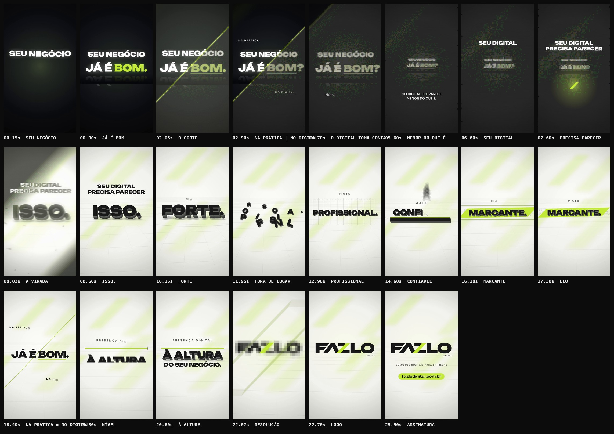

# FAZLO Digital — Reel 001 · "Seu negócio já é bom. Seu digital precisa parecer isso."

Segunda peça da série (pasta `reel-01`), independente do Reel 00.

**Formato:** 9:16 (1080×1920), **26,6 s**, 60 fps, H.264 + AAC 48 kHz, áudio em −14 LUFS.

▶ **Vídeo:** [`output/fazlo-digital-reel-01.mp4`](output/fazlo-digital-reel-01.mp4)
🖼 **Capa:** [`output/capa.png`](output/capa.png) · Storyboard: [`output/storyboard.jpg`](output/storyboard.jpg) · Revisão: [`output/revisao/`](output/revisao)



---

## Conceito: "À altura" — baixa resolução × alta definição

A mensagem: muitos negócios são bons na prática, mas a presença digital não transmite isso. O Reel traduz essa distância numa imagem: **resolução**.

A barra lima da logo vira a **fronteira de resolução**:

- **De um lado está o negócio como ele é:** nítido, iluminado, com tipografia forte.
- **Do outro está o digital.** É a mesma cena, só que:
  - renderizada pequena e ampliada em blocos;
  - sem cor e com contraste lavado;
  - atrasada e a 12 quadros por segundo, com linhas fora de sincronia;
  - e o "JÁ É BOM." vira **"JÁ É BOM?"**.

Ninguém precisa explicar: a mesma frase, cortada ao meio, mostra a diferença de percepção.

**A virada:** a barra se abre e traz um mundo novo. É um estúdio claro em alta definição, com tipografia preta em volume, sombras reais e a logo na sua versão escura oficial. Ali, cada qualidade ganha um movimento que a demonstra, em vez de só aparecer escrita.

**Conteúdo (somente informação verificada).** O site oficial continua inacessível neste ambiente (bloqueado pela política de rede e sem resultados em buscas). Os textos vêm do briefing:

- a ideia central;
- os atributos "mais forte, mais profissional, mais confiável e mais marcante";
- "soluções digitais para empresas";
- o endereço.

Não há clientes, números, resultados nem lista de serviços.

## Roteiro (120 BPM · 1 compasso = 2 s)

| Tempo | Compasso | Cena | O que acontece |
|---|---|---|---|
| 0–2 s | 1 | **O negócio** | Num palco escuro e nítido, **SEU NEGÓCIO** cai letra a letra com a câmera recuando. **JÁ É BOM.** bate no 2º tempo, com "BOM." em lima, um sublinhado que se desenha e o reflexo no piso. |
| 2–4 s | 2 | **O corte** | A barra lima atravessa a tela na diagonal. Atrás dela, o lado de baixo vira o "digital": pixelado, apagado, atrasado, picotado. O ponto final vira **"?"**. Rótulos: **NA PRÁTICA** e **NO DIGITAL**. |
| 4–6 s | 3 | **O digital toma conta** | O lado pixelado avança e engole a tela, e tudo encolhe para menos da metade. Narração: "No digital, ele parece menor do que é." |
| 6–8 s | 4 | **Travado** | A imagem trava duas vezes. Nítidas por cima do digital apagado, entram **SEU DIGITAL / PRECISA PARECER**, e uma pequena barra lima acende e cresce no centro. |
| 8–10 s | 5 | **ISSO.** | **A virada:** a barra se abre em uma faixa que varre a tela. Os pixels do digital se soltam nas bordas e viram peças nítidas, e por trás surge o estúdio claro. **ISSO.** em tipografia preta com volume. |
| 10–12 s | 6 | **MAIS FORTE.** | **Peso:** a palavra cai do alto e esmaga o chão, com poeira, onda de pressão e tremor. |
| 12–14 s | 7 | **MAIS PROFISSIONAL.** | **Precisão:** as letras chegam tortas e fora de lugar e se encaixam todas no golpe. Guias, régua e nós lima se desenham, e uma linha de alinhamento corre pela base. |
| 14–16 s | 8 | **MAIS CONFIÁVEL.** | **Fundação:** uma base sólida sobe do chão e cada letra pousa nela em semicolcheias. A última trava com um brilho lima. |
| 16–18 s | 9 | **MAIS MARCANTE.** | **Marca:** a barra lima carimba atrás da palavra, e ecos da palavra se expandem a cada tempo. |
| 18–22 s | 10–11 | **À altura** | A fronteira volta, agora sem diferença: **NA PRÁTICA** e **NO DIGITAL** mostram o mesmo "JÁ É BOM.", nítido dos dois lados. Uma **linha de nível** lima marca a altura do negócio, e **À ALTURA** sobe do chão até encostar nela. Fecha com "PRESENÇA DIGITAL · À ALTURA · DO SEU NEGÓCIO." |
| 22–26,6 s | 12–13 | **A marca** | A barra chega grande e pousa no lugar exato da barra da logo. A logo **resolve de pixel a nítida** em quatro degraus no ritmo e recebe um brilho; depois entram "SOLUÇÕES DIGITAIS PARA EMPRESAS" e **fazlodigital.com.br** numa pílula lima. |

## Direção de arte

- **Dois mundos:**
  - **Ato 1:** palco escuro e nítido contra o "digital" em baixa resolução. O efeito é feito de verdade: a cena é renderizada em 1/12 a 1/20 da resolução, sem cor, posterizada, com ruído, a 12 qps com atraso, linhas deslocadas e varredura.
  - **Atos 2 e 3:** estúdio claro (`#F3F3F3`, o painel da folha de marca), com piso em perspectiva, barras lima desfocadas em profundidade e tipografia **preta com volume** e sombra no chão.
- **A barra da logo** é a fronteira, a abertura da virada, o carimbo do MARCANTE, a linha de nível do "à altura" e, por fim, a barra da própria logo.
- **Logo:** versão escura oficial (letras `#181918`, barra lima), igual à da folha de marca enviada. Ela foi gerada do arquivo-mestre em alta resolução trocando **apenas** a cor das letras (`tools/logo_variant.py`); o desenho não muda. A resolução pixelada é só uma transição de 0,5 s; depois a logo é o arquivo intacto.
- **Tipografia:** Unbounded e Sora (marca); na capa e no Ato 1, "BOM." em lima.
- **Diferente do Reel 00:** o Reel 00 é todo escuro, com partículas, painéis e túnel. Este é construído sobre contraste de resolução e termina claro.

## Som — o mesmo tema em lo-fi e em hi-fi

Trilha e efeitos **sintetizados do zero** (numpy/scipy), 120 BPM, Fá menor → Lá bemol maior.

- **c.1:** o tema (piano elétrico FM) toca limpo, em estéreo.
- **c.2–4, o "alto-falante ruim":** no corte da barra, o **mesmo tema** passa a soar assim:
  - mono, em banda estreita (330 Hz–3 kHz);
  - 6 bits, taxa reduzida a 6 kHz;
  - com chiado, estalos e oscilação de fita, e a rotação cai cerca de 60 cents até o fim do ato;
  - trava junto com a imagem.

  Medido: correlação L/R 0,99 e energia concentrada em 250–2000 Hz.
- **c.5, a virada:** a **assinatura sonora da marca** (a varredura da esquerda para a direita) abre a alta fidelidade. O tema volta largo, com bateria em meio-tempo, 808, cordas e metais.
- **Atributos:** cada um tem o seu golpe:
  - FORTE: impacto e metais graves;
  - PROFISSIONAL: estalo seco e acorde curto, depois ticks de régua;
  - CONFIÁVEL: um bloco afinado por letra e uma trava metálica;
  - MARCANTE: carimbo com ecos.
- **À altura:** respiro com o tema em sino, a linha de nível e o impacto quando a palavra encosta.
- **Marca:** assinatura completa ("o corte": varredura + Lá bemol 5 → Mi bemol 6) e degraus de resolução que soam cada vez mais limpos.
- **Assinatura compartilhada:** passou a viver em [`tools/audio/fzbrand.py`](../../tools/audio/fzbrand.py), para toda a série usar a mesma.
- **Master:** −14 LUFS; pico real −2,6 dBTP no MP4.

## Revisão

`npm run qa -- 01` gera [`relatorio-tecnico.txt`](output/revisao/relatorio-tecnico.txt), [`sincronia.txt`](output/revisao/sincronia.txt), [`zonas-seguras.jpg`](output/revisao/zonas-seguras.jpg) e [`capa-no-feed.jpg`](output/revisao/capa-no-feed.jpg).

**Técnica (aprovada):**

- 1080×1920, 60 fps, 1.596 quadros;
- H.264 High yuv420p, AAC 48 kHz estéreo;
- 26,600 s de vídeo e de áudio;
- **−14,1 LUFS** e pico real **−2,6 dBTP**;
- sem trechos pretos nem imagem congelada (as travadas do digital duram menos de 0,25 s); o 1º quadro já tem imagem;
- capa 1080×1920.

**Sincronização (aprovada):**

1. o áudio do MP4 é a trilha, sem deslocamento (0,0 ms);
2. 8 golpes-chave caem no instante do evento visual, com **desvio médio de 5,1 ms e máximo de 9,3 ms**. São eles: abertura, JÁ É BOM., o corte, a virada, FORTE, o encaixe do PROFISSIONAL, o carimbo e a marca;
3. a imagem reage nos 6 golpes principais.

**Ajustes feitos na revisão:**

- as barras desfocadas do estúdio apareciam como retângulos (o sprite cortava o desfoque);
- menos ruído e um cinza mais neutro no "digital";
- reflexo no piso no Ato 1;
- "À ALTURA" reconstruído como herói literal, com linha de nível e palavra que sobe;
- recuo de câmera e brilho no primeiro golpe;
- "ISSO." e a base do "CONFIÁVEL" afastados da coluna de ações;
- ataque de 3 ms nos impactos: o AAC gerava pré-eco de 21 ms antes do "JÁ É BOM.", e o "slam" medido no MP4 foi de −29,3 ms para −1,8 ms.

## Arquivos-fonte

```
reels/reel-01/
  reel.json            # metadados, fontes, logo clara e escura, QA, storyboard
  src/anim.js          # ato 1 (fronteira de resolução), virada, estúdio claro, atributos, à altura, marca, capa, cues
  scripts/audio.py     # trilha lo-fi -> hi-fi, efeitos por cue, master
  audio/cues.json      # 72 eventos de som exportados da animação
  audio/trilha.wav
  output/              # vídeo, capa, storyboard, revisão
```

### Como renderizar (na raiz do repositório)

```bash
npm run build -- 01                  # cues -> áudio -> vídeo -> capa -> storyboard -> QA  (~6 min)
npm run dev                          # preview: /core/player.html?reel=reel-01
npm run stills -- 01 2.8,8.1,20.6    # quadros avulsos
```

### Onde editar

- **Tempo:** `BPM`, o objeto `T` (um compasso por cena), `SWEEP` (virada) e `FREEZE` (travadas do digital).
- **O "digital":** tamanho do pixel em `lofiBlock`, quadros por segundo e atraso em `lofiTime`, cor e posterização em `renderLofi`, avanço da fronteira em `uBound`.
- **Atributos:** uma função por cena: `sceneForte`, `sceneProf`, `sceneConf`, `sceneMarc`, `sceneAltura`.
- **Som:**
  - tema em `MOTIF` e harmonia em `CH`/`PROG`;
  - o alto-falante ruim em `lofi()`;
  - a assinatura em `tools/audio/fzbrand.py`.
