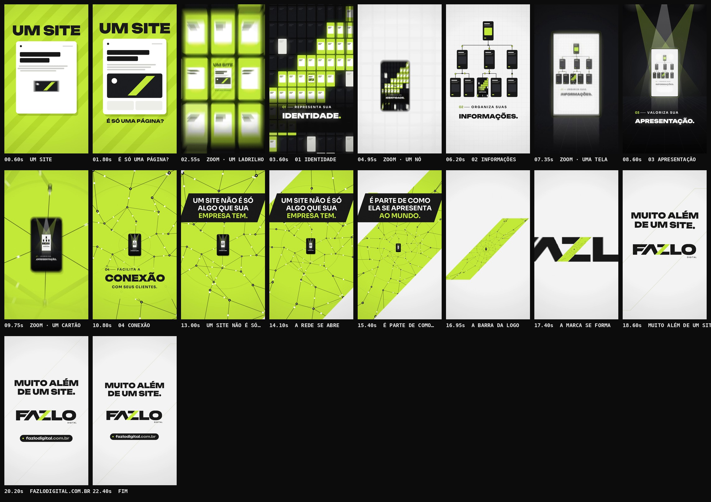

# FAZLO Digital — Reel 002 · "Muito além de um site"

Terceira peça da série (pasta `reel-02`), independente dos Reels 00 e 001.

**Formato:** 9:16 (1080×1920), **23,0 s**, 60 fps, H.264 + AAC 48 kHz, áudio em −14 LUFS.

▶ **Vídeo:** [`output/fazlo-digital-reel-02.mp4`](output/fazlo-digital-reel-02.mp4)
🖼 **Capa:** [`output/capa.png`](output/capa.png) · Storyboard: [`output/storyboard.jpg`](output/storyboard.jpg) · Revisão: [`output/revisao/`](output/revisao)



---

## Conceito: zoom infinito — cada salto mostra o que o site faz parte

A mensagem: um site não é só algo que a empresa tem; ele faz parte de como ela se apresenta ao mundo. O Reel transforma o "muito além" em movimento de câmera.

- **Tudo começa numa página.** É um cartão simples, montado bloco a bloco, com a pergunta **"É SÓ UMA PÁGINA?"**.
- **A câmera se afasta sem nenhum corte**, e a cada compasso a página se revela parte de algo maior. Cada nível é um mundo próprio, com cor, desenho, tipografia e animação, e contém o anterior:

  | Nível | Onde a página estava |
  |---|---|
  | **01 Identidade** | Um ladrilho num mosaico de páginas, cujos ladrilhos lima formam a barra da marca. |
  | **02 Informações** | Uma tela num mapa do site que se organiza. |
  | **03 Apresentação** | Um monólito iluminado num palco. |
  | **04 Conexão** | O centro de uma rede que se espalha. |

- **Ao fim, a rede inteira estava dentro da barra lima da logo.** A câmera pousa na marca: **MUITO ALÉM DE UM SITE.**

Não há "antes e depois": a página nunca é trocada por outra melhor. Ela continua lá, no centro de cada nível, cada vez menor, e o que cresce é o contexto.

**Conteúdo (somente informação verificada).** O site oficial continua inacessível neste ambiente (bloqueado pela política de rede e sem resultados em buscas). Os textos vêm do briefing:

- as quatro funções do site: representa a identidade, organiza as informações, valoriza a apresentação e facilita a conexão com clientes;
- a frase central;
- o endereço.

Não há clientes, números, resultados, depoimentos nem promessas comerciais.

## Roteiro (100 BPM · 1 compasso = 2,4 s · 1 salto de zoom por compasso)

| Tempo | Compasso | Cena | O que acontece |
|---|---|---|---|
| 0–2,4 s | 1 | **A página** | Sobre um fundo lima com listras diagonais em movimento, **UM SITE** bate na tela. Um cartão branco se monta no ritmo: cabeçalho, linhas, imagem com uma barra inclinada e botões. Sobe **É SÓ UMA PÁGINA?** |
| 2,4–4,8 s | 2 | **01 Identidade** | **1º salto:** o cartão era um ladrilho num mosaico de centenas de páginas no escuro. Os ladrilhos lima desenham a barra da logo e viram numa onda diagonal a cada tempo. **REPRESENTA SUA / IDENTIDADE.** entra letra a letra, como carimbo. |
| 4,8–7,2 s | 3 | **02 Informações** | **2º salto:** o mosaico era a tela de um nó num mapa do site, sobre papel quadriculado. As ligações se desenham em ordem, com pulsos lima, e os nós aparecem. Em **INFORMAÇÕES.** as letras chegam embaralhadas e se ordenam. |
| 7,2–9,6 s | 4 | **03 Apresentação** | **3º salto:** o mapa estava num monólito num palco escuro. Três refletores acendem no ritmo, com poeira na luz e reflexo no piso, e **APRESENTAÇÃO.** é revelada por uma varredura de luz. |
| 9,6–12 s | 5 | **04 Conexão** | **4º salto:** o palco era um cartão no centro de uma rede infinita sobre lima. A rede cresce a partir dele, com ondas a cada tempo e pulsos que correm pelas ligações. **CONEXÃO / COM SEUS CLIENTES.** |
| 12–16,8 s | 6–7 | **As frases** | A câmera continua se afastando e acelera. **UM SITE NÃO É SÓ / ALGO QUE SUA / EMPRESA TEM.** e **É PARTE DE COMO / ELA SE APRESENTA / AO MUNDO.** entram linha a linha em placas pretas inclinadas no ângulo da barra. Por volta de 14 s a rede mostra uma borda: ela está dentro de uma faixa inclinada sobre papel. |
| 16,8–18 s | 8 | **A barra** | A faixa encolhe até ser exatamente **a barra da logo**, e as letras FAZLO surgem em volta dela. |
| 18–19,2 s | 8 | **O pouso** | Soco de câmera, pulso lima e um anel inclinado que se expande. **MUITO ALÉM / DE UM SITE.** |
| 19,2–23 s | 9–10 | **Endereço** | **fazlodigital.com.br** entra letra a letra numa pílula preta com ponto lima e brilho. Até o fim, ecos inclinados saem da barra a cada bumbo. |

## Direção de arte

- **Um mundo por nível, sempre dentro da paleta da marca:**
  - lima;
  - preto;
  - papel `#F3F3F3`;
  - tinta `#181918`.

  A alternância entre claro e escuro a cada salto mantém o olho acordado e deixa cada nível reconhecível em miniatura.
- **Desenho recursivo:** `renderLevel(k)` desenha o nível k e, dentro do quadro-filho (ladrilho, nó, tela, cartão, barra da logo), o nível anterior já reduzido. A profundidade da câmera `depth(t)` é contínua, então não há corte nem troca de cena. Dentro de cada nível a câmera segue em aproximação lenta, sem quadros parados.
- **A barra da logo** aparece em todos os níveis:
  - na imagem do cartão;
  - no desenho do mosaico;
  - nos ângulos das placas;
  - no recorte da rede;
  - por fim, no pouso, como a própria barra.
- **Logo:** versão escura oficial (letras `#181918`, barra lima), a mesma usada no Reel 001. No pouso, o arquivo oficial é desenhado intacto, sem redesenho.
- **Sem prints, gravações de tela ou mockups como protagonistas.** A "página" do início é um cartão abstrato de blocos e fica 2,4 s em cena. O tema do vídeo é justamente ela deixar de ser o centro.
- **Tipografia:**
  - Unbounded nas palavras-título;
  - Sora nas frases e rótulos.

  Nas frases, a placa preta garante leitura sobre o lima, a rede e o papel.
- **Diferente dos Reels anteriores:**
  - o Reel 00 é escuro, com partículas, painéis e túnel;
  - o Reel 001 é um contraste de resolução com "antes e depois";
  - este é um único plano-sequência de zoom, sem comparação.

## Som — uma trilha que cresce junto com o mundo

Trilha e efeitos **sintetizados do zero** (numpy/scipy), 100 BPM, Dó menor → Mi bemol maior. Como a imagem, a música é **aditiva**: cada salto acrescenta uma camada.

| Compasso | Cena | Camadas |
|---|---|---|
| c.1 | página | marimba FM em semicolcheias (acentos 3-3-2), bumbo leve e cordas |
| c.2 | identidade | + baixo e palmas |
| c.3 | informações | + chimbal e percussão (o ritmo se organiza) |
| c.4 | apresentação | + coro e viradas de tom (o palco se ilumina) |
| c.5–7 | conexão e frases | groove completo em quatro tempos, tema de sintetizador e rufar de caixa subindo no c.7 |
| c.8 | a barra | a bateria some e fica só o acorde suspenso |
| 18 s | o pouso | resolve em Mi bemol maior |
| c.9–11 | endereço | groove leve e arpejo final |

**Cada salto tem:**

- um impacto;
- o ar se abrindo;
- um **sino FM que sobe de nota a cada nível**: Lá bemol, Dó, Mi bemol, Sol;
- um respiro de 60 ms antes do golpe, para o salto "cair".

**Assinatura da marca** ([`tools/audio/fzbrand.py`](../../tools/audio/fzbrand.py), a mesma da série):

- "o corte" quando a barra aparece;
- a assinatura completa no pouso: varredura + Lá bemol 5 → Mi bemol 6.

**Mixagem pensada para o celular:**

- baixo com harmônicos e bumbos com corte em 38 Hz;
- EQ final com menos subgrave e mais presença.

A energia por faixa foi medida e ficou equilibrada como a do Reel 00.

**Master:** −14 LUFS; pico real −1,9 dBTP no MP4.

## Revisão

`npm run qa -- 02` gera [`relatorio-tecnico.txt`](output/revisao/relatorio-tecnico.txt), [`sincronia.txt`](output/revisao/sincronia.txt), [`zonas-seguras.jpg`](output/revisao/zonas-seguras.jpg) e [`capa-no-feed.jpg`](output/revisao/capa-no-feed.jpg).

**Técnica (aprovada):**

- 1080×1920, 60 fps, 1.380 quadros;
- H.264 High yuv420p, AAC 48 kHz estéreo;
- 23,000 s de vídeo e de áudio;
- **−14,0 LUFS** e pico real **−1,9 dBTP**;
- sem trechos pretos nem imagem congelada; o 1º quadro já tem imagem;
- capa 1080×1920.

**Sincronização (aprovada):**

1. o áudio do MP4 é a trilha, sem deslocamento (0,0 ms);
2. 6 golpes-chave caem no instante do evento visual, com **desvio médio de 6,4 ms e máximo de 6,8 ms**: a abertura, os 4 saltos e o pouso;
3. a imagem reage nos 5 golpes principais.

**Legibilidade e zonas seguras:** todo texto fica fora das áreas cobertas pela interface do Reels: topo, rodapé e coluna de botões à direita.

**Ajustes feitos na revisão:**

- **Abertura:** o "UM SITE" começava grande demais. Agora entra a 106% e mantém margem no 1º quadro.
- **Frases:** a placa lima sumia sobre o fundo lima e virou placa preta. A saída agora é uma varredura, em que a borda esquerda da placa leva o texto junto, sem deixar resíduos.
- **Logo:** as letras surgiam tarde e a barra ficava sozinha na tela. Agora aparecem antes.
- **Palavras-título:** "IDENTIDADE.", "INFORMAÇÕES.", "APRESENTAÇÃO." e "CONEXÃO" invadiam a coluna de botões. Ficaram com 740–760 px de largura, com o rótulo do capítulo alinhado à palavra.
- **Fim:** o cartão final estava parado demais e ganhou ecos inclinados que saem da barra a cada bumbo.
- **Pouso:**
  - o clarão lima em modo *screen* desaparecia no papel;
  - virou um pulso lima em *multiply*, junto de um soco de câmera de 6%;
  - a reação medida passou a 11,2, contra 2,9 de base.
- **Graves:** o subgrave dominava a trilha (energia abaixo de 60 Hz a −3,9 dB do total). Foi para −6,0 dB, com mais médios.
- **Ataques adiantados:** os ataques dos saltos chegavam 26–34 ms antes, porque os sons invertidos de preparação terminavam no próprio golpe. Agora terminam 60 ms antes, com respiro, e o desvio ficou entre −4 e −7 ms.
- **Pico real:** o AAC levava o pico a −0,6 dBTP. Com ataque de 3 ms em todo o impacto, no clique e no bumbo, e com folga no golpe de abertura, ficou em −1,9 dBTP.

## Arquivos-fonte

```
reels/reel-02/
  reel.json            # metadados, fontes, logo clara e escura, QA, storyboard
  src/anim.js          # os 6 níveis, a câmera contínua, frases, fechamento, capa, cues
  scripts/audio.py     # trilha aditiva, efeitos por cue, master
  audio/cues.json      # 48 eventos de som exportados da animação
  audio/trilha.wav
  output/              # vídeo, capa, storyboard, revisão
```

### Como renderizar (na raiz do repositório)

```bash
npm run build -- 02                  # cues -> áudio -> vídeo -> capa -> storyboard -> QA  (~4 min)
npm run dev                          # preview: /core/player.html?reel=reel-02
npm run stills -- 02 3.6,10.8,18.6   # quadros avulsos
```

### Onde editar

- **Tempo:**
  - `BPM` e o objeto `T` (um compasso por nível);
  - `TR`, a duração de cada salto;
  - `depth(t)`, a curva da câmera: aproximações, saltos e a aceleração final.
- **Níveis:** uma função de desenho por nível (`drawL0` … `drawL5`). Em `LV`, cada nível guarda:
  - onde fica o quadro-filho (`A`);
  - a forma do recorte (`clip`).
- **Textos:** `FR1`/`FR2` (frases); `fechamento()` (MUITO ALÉM e endereço).
- **Som:**
  - harmonia em `CH`/`PROG`;
  - camadas por compasso no bloco "partes";
  - sinos dos saltos em `LEVEL_BELL`;
  - efeitos por cue em `fx()`;
  - assinatura em `tools/audio/fzbrand.py`.
