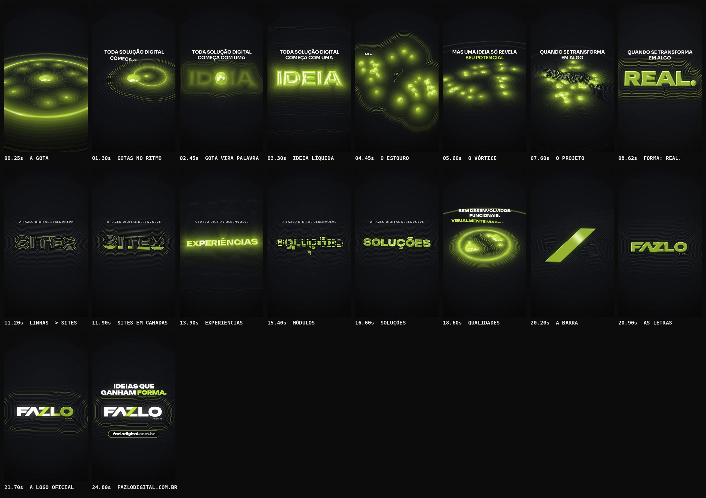

# FAZLO Digital — Reel 003 · "Ideias que ganham forma"

Quarta peça da série (pasta `reel-03`), independente dos Reels 00, 001 e 002.

**Formato:** 9:16 (1080×1920), **25,7 s**, 60 fps, H.264 + AAC 48 kHz, áudio em −14 LUFS.

▶ **Vídeo:** [`output/fazlo-digital-reel-03.mp4`](output/fazlo-digital-reel-03.mp4)
🖼 **Capa:** [`output/capa.png`](output/capa.png) · Storyboard: [`output/storyboard.jpg`](output/storyboard.jpg) · Revisão: [`output/revisao/`](output/revisao)



---

## Conceito: a matéria das ideias

Toda solução digital começa com uma ideia, mas ela só revela seu potencial quando se transforma em algo real. O Reel mostra essa transformação acontecendo de verdade numa **matéria lima viva**, com três estados:

| Estado | Visual | O que representa |
|---|---|---|
| **LÍQUIDO** | brilha, ondula, se funde e se divide em gotas | a ideia: energia, potencial, instabilidade |
| **PROJETO** | só as curvas de nível da forma, em linhas técnicas finas | o desenvolvimento: precisão, planejamento |
| **SÓLIDO** | relevo com chanfro nítido, faces acetinadas e reflexo duro | a forma: algo real, construído |

**Um plano-sequência, sem cortes.** A matéria vive num plano no espaço que a câmera vê:

- de cima, como um chão escuro em perspectiva, onde as gotas caem, giram e respingam;
- de frente, quando vira palavra.

**Assinatura visual.** Em volta de tudo, as **curvas de nível do campo** formam uma aura topográfica. As ondas de cada impacto correm por essas curvas.

**As palavras são feitas da própria matéria.** Elas não são texto animado: o líquido escorre para dentro das letras, a forma se rearranja em linhas e é construída em camadas, os módulos se encaixam. As frases de apoio, pequenas e nítidas, só conduzem a leitura.

**Conteúdo (somente informação verificada).** O site oficial continua inacessível neste ambiente: está bloqueado pela política de rede e não aparece em buscas. Os textos vêm do briefing:

- a ideia central;
- "sites profissionais, experiências digitais e soluções personalizadas para empresas";
- "bem desenvolvidos, funcionais e visualmente marcantes";
- o endereço.

Não há clientes, números, resultados nem promessas comerciais.

## Roteiro (112 BPM · 1 compasso = 2,14 s)

| Tempo | Compasso | Cena | O que acontece |
|---|---|---|---|
| 0–2,1 s | 1 | **Gênese** | Uma gota lima cai num plano escuro visto de cima. Vêm o respingo, um anel e uma onda que corre pelas curvas de nível até o horizonte. Outras três gotas caem no ritmo e escorrem para o centro. **TODA SOLUÇÃO DIGITAL / COMEÇA COM UMA** |
| 2,1–4,3 s | 2 | **IDEIA** | A câmera sobe até ficar de frente e a gota escorre para dentro das letras líquidas de **IDEIA**, que brilham e ondulam. |
| 4,3–6,4 s | 3 | **Potencial** | No golpe, a palavra estoura em 30 gotas. A câmera desce e o plano gira enquanto as gotas orbitam num vórtice. **MAS UMA IDEIA SÓ REVELA / SEU POTENCIAL** |
| 6,4–8,6 s | 4 | **Projeto** | As gotas espiralam para o centro. O projeto técnico de **REAL.** cresce em linhas a partir do esqueleto das letras. **QUANDO SE TRANSFORMA / EM ALGO** |
| 8,6–10,7 s | 5 | **Forma** | **O golpe:** as gotas disparam para dentro do projeto, o líquido o preenche e solidifica numa varredura de 0,2 s, e a câmera bate de frente. Surge **REAL.** sólido, com onda de choque nas curvas de nível e um brilho que atravessa. |
| 10,7–12,9 s | 6 | **SITES** | **A FAZLO DIGITAL DESENVOLVE** · REAL. volta a ser projeto, as linhas se rearranjam em SITES e a palavra é **construída em 8 camadas**, uma por semicolcheia. **PROFISSIONAIS** |
| 12,9–15,0 s | 7 | **EXPERIÊNCIAS** | O sólido derrete e flui até virar **EXPERIÊNCIAS**, líquido e com ondas de luz. **DIGITAIS** |
| 15,0–17,1 s | 8 | **SOLUÇÕES** | A forma congela, se parte em módulos e as peças deslizam e **encaixam uma a uma** em **SOLUÇÕES**. **PERSONALIZADAS** |
| 17,1–19,3 s | 9 | **Propósito** | A palavra derrete numa poça de gotas que giram. Cada qualidade tem o seu estado da matéria: **BEM DESENVOLVIDOS.** são as linhas que pulsam, **FUNCIONAIS.** é tudo virando sólido por um instante, **VISUALMENTE MARCANTES.** é um respingo com anel. |
| 19,3–21,4 s | 10 | **A barra** | As gotas se alinham no eixo da barra da logo e, no golpe, a barra se materializa. Ela solidifica, encolhe até o tamanho exato da barra da logo, e as letras FAZLO crescem do esqueleto em volta dela. |
| 21,4–23,6 s | 11 | **A marca** | Um brilho atravessa e, atrás dele, aparece a **logo oficial** (arquivo intacto). A matéria vira só a aura de curvas de nível, que pulsa no tempo. **IDEIAS QUE / GANHAM FORMA.** |
| 23,6–25,7 s | 12 | **Endereço** | **fazlodigital.com.br** numa pílula com contorno lima, letra a letra. |

## Direção de arte

- **Paleta:** só a da marca. O lima é a matéria; o branco é a tipografia e as letras da logo; o preto profundo é o palco.
- **Material:**
  - o líquido tem cúpula, brilho interno nas bordas finas, halo e reflexos de estúdio que deslizam;
  - o sólido tem chanfro nítido que pega a luz, faces acetinadas e sombra de contato.
- **Profundidade:**
  - a câmera alterna entre a vista de chão em perspectiva (gênese, vórtice, propósito, a barra) e a vista frontal (as palavras), sempre em movimento contínuo;
  - impactos têm onda de choque nas curvas de nível, tremor e soco de câmera.
- **Logo:** a matéria forma a barra e as letras na geometria exata da logo oficial (medida no arquivo, `brand/tokens.js`). A revelação mostra o **arquivo oficial intacto** (letras brancas, barra lima). A logo não é redesenhada.
- **Tipografia:**
  - Unbounded 900 nas palavras de matéria e no título;
  - Sora nas frases de apoio, nos rótulos e nos complementos em lima espaçado.
- **Diferente dos Reels anteriores:**

  | Reel | Linguagem |
  |---|---|
  | 00 | gráficos planos, partículas, painéis e túnel |
  | 001 | contraste de resolução e "antes e depois" |
  | 002 | zoom infinito sobre ilustrações planas |
  | **003** | material renderizado com luz (relevo, reflexo, estados físicos) num plano em 3D: uma linguagem nova na série |

- **Sem** telas, computadores, mockups ou demonstrações de sites.

## Técnica: um shader de campo de distância

A matéria é renderizada em **WebGL2** por [`src/matter.js`](src/matter.js), num canvas próprio que é copiado para o quadro 2D do motor compartilhado. O motion blur e o pós-processamento continuam no motor.

- **Campo de distância (SDF)**, calculado em meia resolução. Ele reúne:
  - as palavras: glifos rasterizados com distância euclidiana exata, num atlas;
  - as gotas: união suave de círculos;
  - a barra: paralelogramo analítico;
  - a logo: SDF calculado do canal alfa do arquivo oficial;
  - um ruído que faz o líquido "ferver".

  A **transição entre palavras é a interpolação dos campos**, por isso as letras se transformam umas nas outras.
- **Luz em resolução cheia:**
  - antisserrilhado exato;
  - normais pelo gradiente do campo;
  - perfil de relevo (cúpula no líquido, chanfro no sólido);
  - reflexo de estúdio com fresnel;
  - curvas de nível e ondas;
  - sombra de contato.
- **Estados e frentes:** líquido, projeto e sólido se misturam por pixel. Frentes que varrem a forma solidificam, constroem por camadas ou revelam.
- **Câmera:** o plano é girado em 3D e projetado por uma homografia (tela → plano).
- **Motor compartilhado:** a única mudança foi o `core/player.html`, que agora aceita `scripts` no `reel.json` (scripts auxiliares carregados antes da animação). É opcional, e os Reels anteriores não mudam.

## Som — a trilha segue os estados da matéria

Trilha e efeitos **sintetizados do zero** (numpy/scipy). 112 BPM, Si bemol menor → **Ré bemol maior**; o acorde final contém Lá bemol e Mi bemol, as notas da assinatura.

**Timbres por estado:**

- **Líquido:**
  - gotas afinadas, em que a frequência sobe no ataque como numa gota real; as três gotas do início são as notas Fá, Lá bemol e Ré bemol;
  - bolhas, vidro FM e deslizes "gosmentos".
- **Projeto:** bipes senoidais e ticks no tempo, nos momentos de desenho e rearranjo das linhas.
- **Sólido:**
  - impactos de subgrave contido;
  - blocos afinados: as 8 camadas de SITES sobem uma escala e cada módulo de SOLUÇÕES encaixa com uma nota;
  - ressonâncias de cristal (parciais inarmônicos) quando o líquido congela.

**Arranjo:**

| Compasso | Cena | O que toca |
|---|---|---|
| c.1 | gênese | um pulso grave como coração |
| c.2 | IDEIA | o pad abre e nasce um arpejo de vidro |
| c.3 | potencial | entram bateria em meio-tempo e baixo |
| c.4 | projeto | rufar e filtro abrindo, com um respiro de 60 ms antes do golpe |
| c.5–8 | forma e serviços | groove completo; c.7 fica fluido |
| c.9 | propósito | três golpes, um por qualidade |
| c.10 | a barra | a bateria sai; "o corte" da assinatura soa quando a barra surge |
| c.11 | a marca | a assinatura completa (varredura + Lá bemol 5 → Mi bemol 6) na revelação da logo |
| c.12 | endereço | pings de sonar com as ondas da aura |

**Mixagem pensada para o celular:**

- baixo que vive nos harmônicos;
- bumbos e impactos com corte em 45 Hz;
- EQ final com menos subgrave e mais presença.

**Master:** −14 LUFS; pico real −2,0 dBTP no MP4.

## Revisão

`npm run qa -- 03` gera [`relatorio-tecnico.txt`](output/revisao/relatorio-tecnico.txt), [`sincronia.txt`](output/revisao/sincronia.txt), [`zonas-seguras.jpg`](output/revisao/zonas-seguras.jpg) e [`capa-no-feed.jpg`](output/revisao/capa-no-feed.jpg).

**Técnica (aprovada):**

- 1080×1920, 60 fps, 1.543 quadros;
- H.264 High yuv420p, AAC 48 kHz estéreo;
- 25,717 s de vídeo e de áudio (Δ 3 ms);
- **−13,9 LUFS** e pico real **−2,0 dBTP**;
- sem trechos pretos nem imagem congelada; o 1º quadro já tem imagem;
- capa 1080×1920.

**Sincronização (aprovada):**

1. o áudio do MP4 é a trilha, sem deslocamento (0,0 ms);
2. 5 golpes-chave caem no instante do evento visual, com **desvio médio de 7,1 ms e máximo de 10,0 ms**: a gota, o estouro, o golpe da forma, a barra e a revelação da logo;
3. a imagem reage nos 4 golpes principais.

**Legibilidade e zonas seguras:** todo texto fica fora das áreas cobertas pela interface do Reels: topo, rodapé e coluna de botões à direita. As frases de apoio têm 52–60 px e os complementos ficam em lima espaçado.

**Ajustes feitos na revisão:**

- **Líquido:**
  - o ruído "amassava" o líquido e virou ruído de baixa frequência;
  - as gotas ganharam cúpula, e o reflexo do estúdio virou um ponto de luz em vez de estourar em branco;
  - os topos planos do líquido têm reflexo mais contido.
- **Sólido:** faces planas acetinadas, com o brilho só nos chanfros. A barra grande deixou de estourar na vista de chão.
- **Projeto de REAL.:** aparecia cedo porque o halo o denunciava. Agora o halo só existe onde a matéria está preenchida, e o projeto cresce do esqueleto das letras junto com as linhas.
- **Abertura:** a câmera começa perto da gota, o respingo enche a tela e o 1º quadro não tem clarão.
- **Módulos de SOLUÇÕES:** viravam ruído; agora deslizam na vertical e encaixam um a um, legíveis.
- **Logo:** as letras condensavam tarde e a barra ficava sozinha. Agora crescem do esqueleto em volta da barra.
- **Golpe da barra:** quase não tinha reação visual. Agora a barra se materializa de uma vez, com soco de câmera.
- **Áudio:** o AAC levava o pico a +0,2 dBTP na revelação e no golpe. Os impactos foram suavizados (ataque de 6 ms no ruído agudo e no prato) e o limitador ganhou mais folga.
- **Render (`tools/render.cjs`):**
  - o `-shortest` do ffmpeg descartava os 3 últimos quadros na multiplexação;
  - o áudio já é cortado com `-t` na duração exata, então a opção foi removida;
  - os vídeos dos Reels anteriores não mudam.
- **Desempenho:** o passe de luz caiu de ~280 para ~140 ms por subquadro, com homografia pré-calculada, saída antecipada para o fundo e gradiente só perto da matéria.

## Arquivos-fonte

```
reels/reel-03/
  reel.json            # metadados, scripts, fontes, logo, QA, storyboard
  src/matter.js        # renderizador da matéria (WebGL2): campo de distância, estados, luz
  src/anim.js          # roteiro: câmera, gotas, palavras, estados por cena, textos, logo, capa, cues
  scripts/audio.py     # trilha e efeitos por cue, master
  audio/cues.json      # 54 eventos de som exportados da animação
  audio/trilha.wav
  output/              # vídeo, capa, storyboard, revisão
```

### Como renderizar (na raiz do repositório)

```bash
npm run build -- 03                  # cues -> áudio -> vídeo -> capa -> storyboard -> QA  (~22 min: WebGL por software)
npm run dev                          # preview: /core/player.html?reel=reel-03
npm run stills -- 03 3.3,8.7,22.6    # quadros avulsos
```

O render usa WebGL2 por software (SwiftShader no Chromium headless) e leva ~0,75 s por quadro.

### Onde editar

- **Tempo:**
  - `BPM` e o objeto `T` (um compasso por cena);
  - `DROPS`, `LAYERS` e `QUAL` (gotas, camadas e qualidades no ritmo).
- **Câmera:** `camRaw(t)` (inclinação, giro, zoom) e `SHAKES`.
- **Matéria por cena:** `matterAt(t)`, que devolve o estado completo para o shader, com seus campos:

  | Campo | O que controla |
  |---|---|
  | `wordA`, `wordB`, `morph` | as palavras e a transição entre elas |
  | `blobs` | as gotas |
  | `slash` | a barra |
  | `solid`, `wordSolid`, `front` | a solidez e as frentes que solidificam |
  | `build` | a construção por camadas e a revelação |
  | `cells` | os módulos |
  | `wave` | as ondas nas curvas de nível |
  | `sweep` | o brilho que varre a forma |
  | `proj` | linhas e preenchimento |

- **Trajetórias das gotas:** `vortexDrops` e `poolDrops`.
- **Material e luz:** `FS_SHADE` em `src/matter.js` (`envLight`, perfis de relevo).
- **Som:**
  - harmonia em `CH`/`PROG`;
  - timbres `glass`, `bloop`, `crystal`, `block`, `reese`;
  - efeitos por cue em `fx()`.
