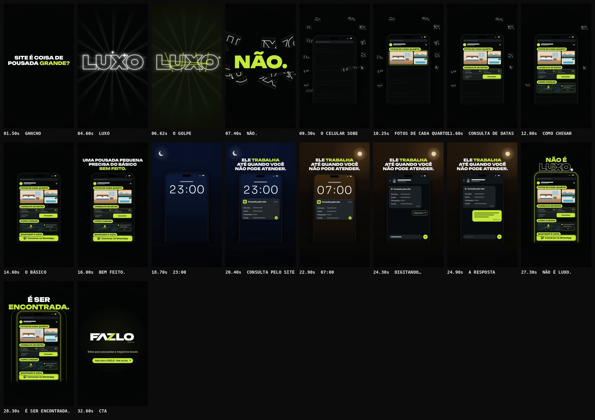

# FAZLO Digital — "Site não é luxo"

Reel da @fazlodigital (pasta `site-nao-e-luxo`). Usa a mesma identidade, o mesmo motor e a mesma linguagem de trilha dos Reels anteriores.

**Status: concluído · em avaliação.**

**Formato:** 9:16 (1080×1920), **33,0 s**, 60 fps, H.264 + AAC 48 kHz, áudio em −14 LUFS. 100% motion graphics. Todas as interfaces são **ilustrativas e genéricas**: nenhuma pousada real, nenhum número inventado (valores, datas e endereço aparecem como barras), nenhuma promessa de preço.

▶ **Vídeo:** [`output/fazlo-digital-site-nao-e-luxo.mp4`](output/fazlo-digital-site-nao-e-luxo.mp4)
🖼 **Capa:** [`output/capa.png`](output/capa.png) · Storyboard: [`output/storyboard.jpg`](output/storyboard.jpg) · Revisão: [`output/revisao/`](output/revisao)



---

## Conceito: o LUXO se desmonta

A palavra **LUXO**, gigante, em contorno branco e com um brilho de propósito exagerado, **racha e se desmonta em peças**. As peças viram os blocos de um site simples, que caem e se encaixam num celular. O que parecia luxo é só o básico bem montado.

**Ritmo de cada cena:** a animação entra no tempo, fica parada para leitura e só então vem a transição.

## Roteiro (100 BPM · 1 tempo = 0,6 s · 55 tempos)

| Tempo | Cena | O que acontece |
|---|---|---|
| 0–4,2 s | **Gancho** | **SITE É COISA DE / POUSADA GRANDE?** sobe palavra por palavra (o 1º quadro já tem texto), com "GRANDE?" em lima, e fica parado para leitura. |
| 4,2–9,0 s | **O mito** | **LUXO** cresce gigante, só em contorno branco (sem dourado), com raios girando, halo pulsando, dois reflexos varrendo as letras e estrelinhas de quatro pontas. **Em 6,6 s, o golpe** ("o corte" da assinatura): uma rachadura lima corre pelas letras e o brilho apaga. **Em 6,75 s** (um 16º depois), as peças se soltam e o **NÃO.** entra em lima. As peças terminam a explosão **em volta** da palavra, nunca por cima. As peças sem traço somem; as 12 com traço esperam em volta do celular. |
| 9,0–18,0 s | **O básico** | O celular sobe com o site vazio (barra de endereço sem domínio e lugares tracejados). Três peças viram o topo do site. A cada 2 tempos, 3 peças se juntam acima do celular, viram um bloco com a etiqueta lima e o bloco cai no lugar, pousando no tempo (10,2 · 11,4 · 12,6 · 13,8 s). De 13,8 a 15,0 s o site montado fica parado com as 4 etiquetas. **UMA POUSADA PEQUENA / PRECISA DO BÁSICO / BEM FEITO.** fica de 15,0 a 17,7 s, com "BEM FEITO." em lima. |
| 18,0–25,8 s | **Trabalha por você** | **Noite:** a tela apaga, o céu escurece, surgem estrelas e a lua sobe. A tela de bloqueio acende e o relógio rola até **23:00**. Em 19,2 s chega a notificação **"Consulta pelo site"**: Entrada · Saída · Hóspedes · Chalé, com os valores em barras e um selo de check lima. **ELE TRABALHA / ATÉ QUANDO VOCÊ / NÃO PODE ATENDER.** fica de 19,5 a 25,5 s, com "TRABALHA" em lima. **Manhã (21,6 s):** a lua se põe, o sol nasce, o céu esquenta e o relógio rola as horas até **07:00**. Em 23,4 s o dono toca a notificação e a conversa abre com a consulta já organizada. Em 24,0 s aparece **"digitando…"** e, em 24,6 s, o balão de resposta **da pousada** (texto em barras, 07:00, duplo check). Não há resposta automática. |
| 25,8–30,0 s | **Virada** | O celular volta ao site montado, com contorno lima e brilho. **NÃO É / LUXO.** (26,0–27,6 s), com "NÃO É" em lima e "LUXO" no mesmo contorno rachado da cena 2. **Em 27,9 s, o golpe:** **É SER / ENCONTRADA.**, com "ENCONTRADA." em lima, e ondas lima saem do celular. |
| 30,0–33,0 s | **CTA** | A logo **FAZLO DIGITAL** se monta centralizada (SVG do kit, 720 px). Depois entram **Sites para pousadas e negócios locais** e a pílula lima **Fale com a FAZLO · link na bio**. |

### Os blocos do site

| Pouso | Etiqueta | Bloco |
|---|---|---|
| 10,2 s | **FOTOS DE CADA QUARTO** | foto ilustrada de um quarto e mais duas (vista e piscina) |
| 11,4 s | **CONSULTA DE DATAS** | Entrada e Saída (valores em barras), Hóspedes e o botão "Consultar" |
| 12,6 s | **COMO CHEGAR** | mapa abstrato com o pino e o endereço em barras |
| 13,8 s | **WHATSAPP À VISTA** | botão lima "Conversar no WhatsApp", com ícone genérico de conversa (sem logo) |

**Etiquetas:** 34 px na queda e **32 px no site montado**, presas na borda de cima de cada bloco e alinhadas a ele (nunca menores que 28 px).

## Direção de arte

- **Cores:** fundo `#050606` com grade de pontos que respira, verde-limão `#C6FA41` e branco. A noite e a manhã tingem o fundo de leve (azul-escuro e um tom quente) e voltam ao preto na virada.
- **Tipografia (fontes oficiais):** Unbounded 900 nos títulos e no LUXO; Sora nas etiquetas, no site, no relógio (Sora 300) e na conversa.
- **LUXO:** o contorno é feito pela silhueta da letra (a letra engordada menos a letra), sem as sobreposições internas dos glifos da fonte. As peças saem de 6 linhas de corte (a palavra vira ~20 polígonos).
- **Celular:** 660 px de largura (x 210–870, fora da coluna de botões à direita), topo em y 470. A parte de baixo **se apaga em degradê antes de y 1560**: nada entra no rodapé seguro. Os títulos ficam acima dele, na faixa y 240–436.
- **Logo:** SVGs do kit oficial: 720 px no CTA e 560 px na capa.

## Som

Trilha e efeitos **sintetizados do zero** (numpy/scipy), seguindo os cues da animação (38 eventos). A paleta é a dos Reels anteriores: 100 BPM, Lá bemol maior.

| Cena | O que toca |
|---|---|
| gancho | pad e vidro esparsos, com uma pulsação grave bem leve |
| o mito | "glamour" exagerado: harpa de vidro subindo, cintilação e sininhos em cascata em cada reflexo; no golpe, **"o corte"** da assinatura e uma rachadura de vidro; no estouro, o vidro se espalha e o NÃO. bate grave; as peças tilintam no ar |
| o básico | o groove entra; cada bloco se forma com um brilho, cai com um sopro que desce e pousa com batida grave e um bloco afinado, em notas que sobem |
| noite | a música fecha num filtro e fica só o pad; tique-taque do relógio; toque de notificação genérico (dois tons de madeira, não é o som do WhatsApp) |
| manhã | o filtro abre e o arpejo volta; o relógio rola com tiques; toque na tela, digitação e "enviado" em dois tons |
| virada | o groove completo; a rachadura pequena em NÃO É LUXO.; respiro de 60 ms e o golpe em É SER ENCONTRADA. |
| CTA | a assinatura completa (varredura + Lá bemol 5 → Mi bemol 6) na logo; Lá bemol maior |

## Capa

[`output/capa.png`](output/capa.png), 1080×1920:

- a logo FAZLO DIGITAL no topo, centralizada (560 px);
- **SITE** em branco, **NÃO É** em lima e **LUXO** grande, no contorno branco rachado, com as peças levemente deslocadas e a fresta lima entre elas;
- todo o título entre y 520 e 1460.

**Regras do briefing, conferidas no QA:** texto dentro do recorte 3:4; canto x ≥ 860 / y 240–440 livre; rodapé y 1560–1680 livre; nada cortado.

## Revisão

<!--QA-->

## Arquivos-fonte

```
reels/site-nao-e-luxo/
  reel.json            # metadados, fontes, parâmetros de QA e storyboard
  src/anim.js          # LUXO (contorno, brilho, rachadura, peças), celular e site, noite/manhã, virada, CTA, capa, cues
  scripts/audio.py     # trilha e efeitos por cue, master
  audio/cues.json      # 38 eventos de som exportados da animação
  audio/trilha.wav
  output/              # vídeo, capa, storyboard, revisão (inclui as folhas de teste das cenas)
```

### Comandos (na raiz do repositório)

```bash
npm run build -- site-nao-e-luxo              # cues -> áudio -> vídeo -> capa -> storyboard -> QA
npm run dev                                   # preview: /core/player.html?reel=site-nao-e-luxo
npm run stills -- site-nao-e-luxo 14.6,24.9   # quadros avulsos em PNG
```
