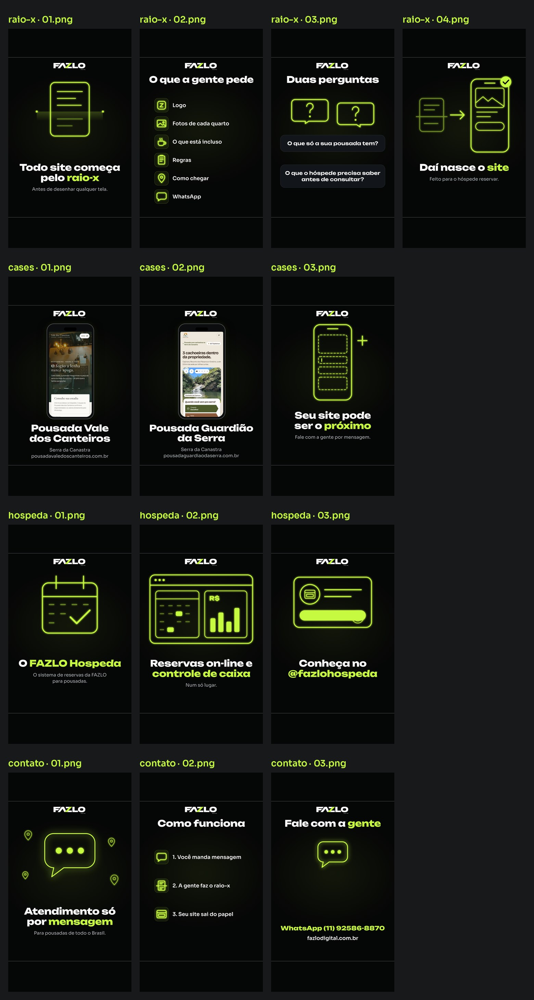

# FAZLO Digital — Stories dos destaques

Stories estáticos (1080×1920) para os destaques do perfil da @fazlodigital. As capas dos destaques ficam em [`../../destaques/`](../../destaques).



| Destaque | Stories |
|---|---|
| **Raio-x** | [`01`](raio-x/01.png) "Todo site começa pelo *raio-x*" · [`02`](raio-x/02.png) "O que a gente pede" (logo, fotos de cada quarto, o que está incluso, regras, como chegar, WhatsApp) · [`03`](raio-x/03.png) "Duas perguntas" · [`04`](raio-x/04.png) "Daí nasce o *site*" |
| **Cases** | [`01`](cases/01.png) Pousada Vale dos Canteiros · [`02`](cases/02.png) Pousada Guardião da Serra (telas reais do topo de cada site, num celular genérico) · [`03`](cases/03.png) "Seu site pode ser o *próximo*" |
| **Hospeda** | [`01`](hospeda/01.png) "O *FAZLO Hospeda*" · [`02`](hospeda/02.png) "Reservas on-line e *controle de caixa*" (painel genérico, nada de tela real do sistema) · [`03`](hospeda/03.png) "Conheça no *@fazlohospeda*" |
| **Contato** | [`01`](contato/01.png) "Atendimento só por *mensagem*" · [`02`](contato/02.png) "Como funciona" (3 passos) · [`03`](contato/03.png) "Fale com a gente": área livre de y 900 a 1260 para o sticker de link |

## Regras

- Unbounded (títulos) + Sora (apoio), lima `#C6FA41`, fundo `#050606`, logo FAZLO DIGITAL do kit no topo (y 286).
- **Faixas livres:** nada em y < 250 (barra do Story) nem em y > 1650 (área de resposta). O script confere e para se algo passar.
- Título com até 2 linhas (o trecho entre *asteriscos* sai em lima); apoio com até 2 linhas. A fonte diminui até caber na largura, sem quebrar em mais linhas.
- Ilustrações em traço lima com brilho, no estilo das capas v2 e das capas do Explica. Ícones genéricos e próprios: nenhum logo de WhatsApp, Instagram ou Booking.
- **Cases:** telas reais já capturadas (Vale: `reels/como-funciona-o-raio-x/src/assets/site/m-00.jpg`; Guardião: `reels/case-guardiao-da-serra/telas/01-topo.png` da branch `claude/fazlo-digital-serie-explica`), copiadas em `src/telas/`. Os dois topos não têm telefone; a captura da Guardião já sai com os telefones desfocados.
- Nada de números, clientes ou resultados inventados, nem depoimentos.

## Refazer

```bash
node tools/stories-destaques.cjs && python3 tools/stories_destaques_previa.py
```
