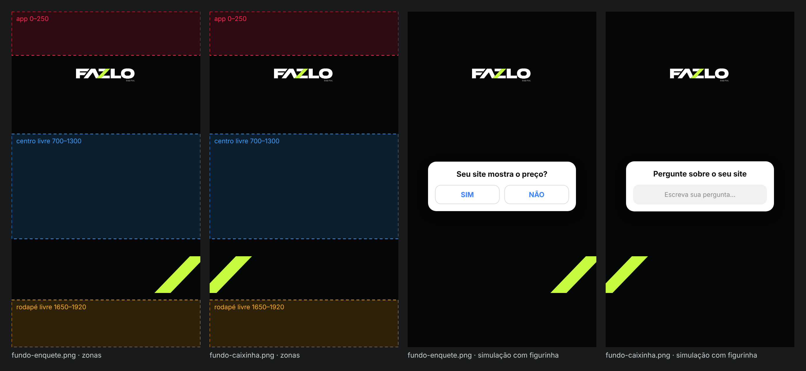

# FAZLO Digital — fundos de Stories (enquete e caixinha)

Fundos para Stories da @fazlodigital. A enquete e a caixinha de perguntas são figurinhas feitas no próprio app, por cima do fundo.

**Status: concluído · em avaliação.**

| Arquivo | Uso | Detalhe lima |
|---|---|---|
| [`fundo-enquete.png`](fundo-enquete.png) | enquete | barra do Z no canto direito de baixo, cortada pela borda |
| [`fundo-caixinha.png`](fundo-caixinha.png) | caixinha de perguntas | a mesma barra no canto esquerdo de baixo, cortada pela borda |



## Regras

- **Formato:** PNG 1080×1920, fundo `#050606` liso.
- **Logo:** FAZLO DIGITAL do kit oficial (`brand/logo/kit/FAZLO-DIGITAL-branca-transparente.svg`), embutida como vetor, sem redesenhar. Tem 360 px de largura, fica centralizada e ocupa y 325–398, abaixo da faixa que o app cobre (y 0–250).
- **Detalhe lima `#C6FA41`:** a barra do Z, com a geometria da marca:
  - inclinação dx/dy = −0,966 e largura = 0,438 × altura;
  - 210 px de altura, entre y 1400 e 1610;
  - cortada pela borda da tela, para ficar discreta.

  As duas peças só mudam no canto da barra.
- **Livres:** o centro (y 700–1300), para o texto e a figurinha do Instagram, e o rodapé (y 1650–1920).

## Revisão

- [`revisao/zonas-e-simulacao.png`](revisao/zonas-e-simulacao.png) mostra as duas peças:
  - com as zonas marcadas: faixa do app, centro livre e rodapé livre;
  - com uma simulação de pergunta e figurinha no centro. A simulação é só para ver o equilíbrio e não vai na peça.
- [`revisao/relatorio.txt`](revisao/relatorio.txt) confere, em cada peça:
  - 1080×1920 e opaca;
  - as três zonas só com o fundo liso;
  - a logo abaixo da faixa do app;
  - só as cores da marca: fundo, lima, o branco da logo e as misturas entre eles nas bordas.

  Resultado: **aprovado**.

## Arquivos-fonte

```
stories/fundos/
  fundos.json        # cores, zonas livres, logo (arquivo, largura, topo), barras de cada peça
  svg/<id>.svg       # cada peça em vetor (1080x1920)
  <id>.png
  revisao/
```

```bash
npm run stories -- fundos     # SVG + PNG, folha de zonas e simulação, relatório (tools/stories.cjs + tools/stories_qa.py)
```
